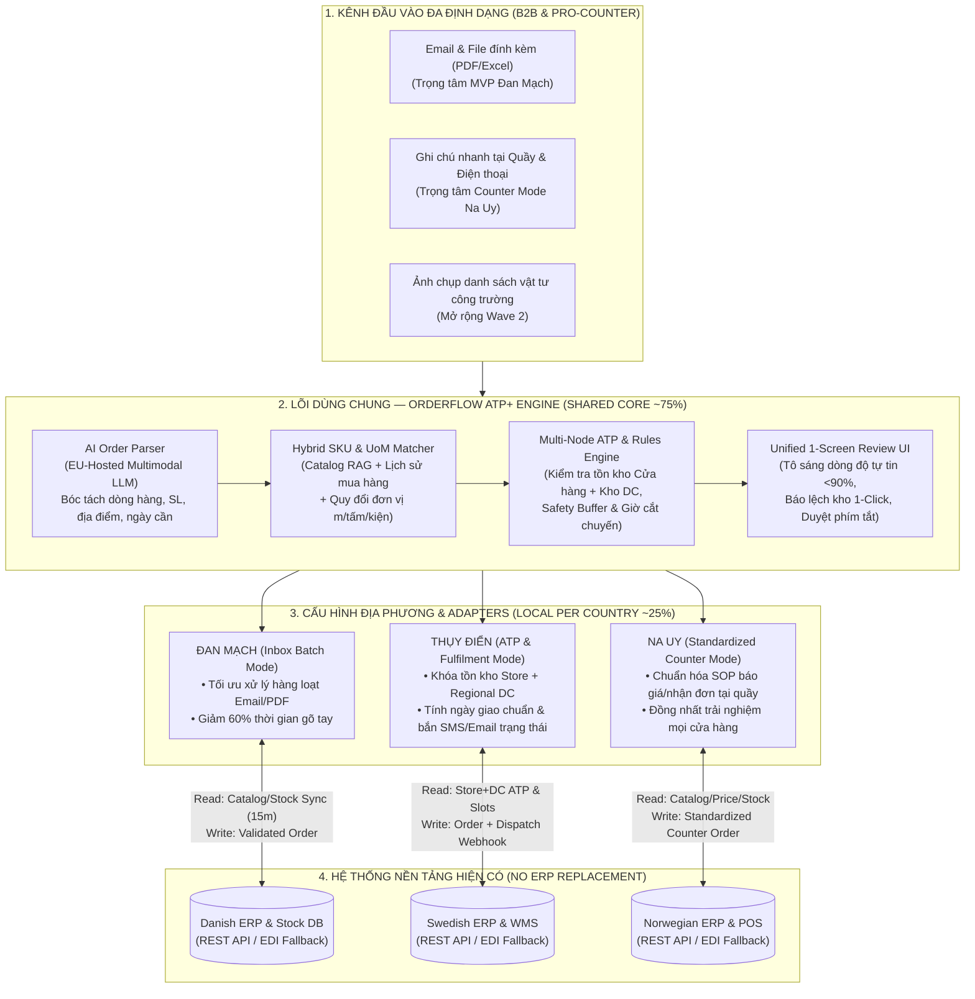

# BÁO CÁO PHÂN TÍCH CHUYÊN SÂU & CHIẾN LƯỢC GIÀNH CHIẾN THẮNG
## Cuộc thi: IT Consultant Challenge 2026 — Round 1 (Netcompany × Code MeLy)

> **Tài liệu này bao gồm 4 phần trọng tâm:**
> 1. **Giải mã toàn diện Đề bài & Bối cảnh thực tế** (Company A ngoài đời thực là ai, văn hóa công nghệ của Netcompany và "ẩn ý" của Ban Giám khảo).
> 2. **Phân tích & Đánh giá Phản biện (Judge Review)** đối với bản đề xuất hiện tại của teammate (`OrderFlow-Proposal-Draft.pdf`).
> 3. **10 Câu hỏi Phản biện Gắt gao nhất từ Ban Giám khảo** & Kịch bản trả lời phòng thủ.
> 4. **Giải pháp Đề xuất Đột phá ("Winning Solution" để đạt Top 1)** — Bao gồm Kiến trúc nâng cấp toàn diện **OrderFlow ATP+** (tận dụng tối đa prototype sẵn có của nhóm), Phương án thay thế độc lập (**NordicFlow DOM Hub**), Mô hình Tài chính/ROI chuẩn CFO và Cấu trúc 10 Slides hoàn chỉnh để sửa bài ngay.

---

# PHẦN 1: GIẢI MÃ ĐỀ BÀI, BỐI CẢNH THỰC TẾ & TIÊU CHÍ CHẤM ĐIỂM

## 1.1. Tổng quan Cuộc thi & Quy định Bắt buộc
* **Đơn vị tổ chức:** **Netcompany** (Tập đoàn tư vấn và dịch vụ CNTT hàng đầu Đan Mạch/Châu Âu với ~10.000 nhân sự tại 10+ quốc gia) phối hợp cùng cộng đồng **Code MeLy**.
* **Yêu cầu đầu ra (Responsibilities):**
  * Bản đề xuất giải pháp tư vấn (**Proposal Deck**) tối đa **10 slides**.
  * Định dạng: **PDF**, ngôn ngữ ưu tiên: **Tiếng Anh (English)**.
  * Hạn chót (Deadline): **22:00 (10 PM), ngày 26/10/2026**.
* **5 Tiêu chí Đánh giá Chính thức (Official Assessment Criteria):**
  1. **Problem Understanding (Hiểu sâu vấn đề):** Đi sâu hơn bề nổi để tìm ra nguyên nhân gốc rễ (*Go beyond the surface and find the real problem*).
  2. **Prioritisation & Critical Thinking (Tư duy phản biện & Ưu tiên hóa):** Phân tích, đánh giá các đánh đổi (trade-offs) và chọn đúng điểm trọng yếu nhất (*Analyse, evaluate and choose what matters most*).
  3. **Business Impact (Tác động kinh doanh):** Chuyển hóa ý tưởng thành giá trị đo lường được bằng số liệu/KPI/ROI thực tế (*Turn ideas into measurable value for the business*).
  4. **Feasible Solution (Giải pháp khả thi):** Giải pháp CNTT thực tế, khả thi về mặt kỹ thuật và vận hành (*Practical, realistic IT solution*).
  5. **Structured Thinking & Innovation (Tư duy cấu trúc & Sáng tạo):** Kết hợp tính sáng tạo với phương pháp tiếp cận logic, mạch lạc (*Combine creativity with a clear and logical approach*).

---

## 1.2. Giải mã "Company A" ngoài đời thực & Ngành Bán lẻ Vật liệu Xây dựng Bắc Âu
Đề bài mô tả **Company A**:
* Nhà bán lẻ vật liệu xây dựng, dụng cụ (tools) và cải tạo nhà cửa (home improvement) hàng đầu Đan Mạch.
* Vận hành **hàng trăm cửa hàng** tại 3 quốc gia Bắc Âu: **Denmark (Đan Mạch), Norway (Na Uy), và Sweden (Thụy Điển)**.
* Phục vụ cả **B2B** (các nhà thầu, doanh nghiệp xây dựng) và **B2C** (khách hàng cá nhân tự sửa chữa nhà cửa - DIY).
* Phương châm/Đặc thù hoạt động: **"One business. Three markets. Different ways of working."**

### Nghiên cứu thực tế (Web Research Insights):
Trong thực tế tại Bắc Âu, chân dung **Company A** được lấy cảm hứng trực tiếp từ các tập đoàn phân phối vật liệu xây dựng lớn của Đan Mạch đã mở rộng qua Na Uy và Thụy Điển (thường qua mua bán & sáp nhập - M&A các chuỗi địa phương), tiêu biểu là:
1. **STARK Group** (Trụ sở tại Đan Mạch, vận hành hàng trăm cửa hàng qua *STARK Danmark*, *Beijer Byggmaterial* tại Thụy Điển, *Neumann Bygg* tại Na Uy): Do lịch sử phát triển và mua lại các chuỗi nội địa ở từng nước, mỗi quốc gia từng vận hành một hệ thống ERP, danh mục mã hàng (SKU), quy trình kho bãi và văn hóa làm việc tại cửa hàng hoàn toàn khác nhau.
2. **Bygma Gruppen** hoặc **XL-BYG**: Đều là các chuỗi vật liệu xây dựng lớn của Đan Mạch có mặt tại Đan Mạch, Thụy Điển và Na Uy, nơi mảng **B2B (nhà thầu chuyên nghiệp) chiếm từ 65% – 75% doanh thu**, trong khi mảng **B2C** tạo lưu lượng khách tại cửa hàng vật lý.

### Đặc thù "Nỗi đau" thực tế của ngành Vật liệu Xây dựng Bắc Âu:
* **Danh mục hàng hóa khổng lồ & phức tạp:** Một chuỗi như Company A quản lý từ **100.000 đến 400.000+ mã SKU** (gỗ xẻ, vật liệu thô, ốc vít, sơn, thiết bị điện nước) với **đơn vị tính (Unit of Measure - UoM)** cực kỳ phức tạp: tấm, thanh, mét dài (linear meter), mét vuông ($m^2$), kiện (pallet), hộp.
* **Ngôn ngữ lóng của thợ thầu (Trade Slang):** Nhà thầu xây dựng đang đứng ngoài công trường ồn ào không bao giờ tra mã SKU 10 chữ số để đặt hàng. Họ gửi email, file PDF bóc tách khối lượng, ảnh chụp danh sách viết tay hoặc gọi điện đọc tên lóng địa phương (ví dụ: *"Cho 20 thanh gỗ C24 45x195 dài 4.8m và 5 bao keo dán gạch loại chống thấm như công trình trước"*).
* **Sự đứt gãy giữa Quầy giao dịch (Store Counter), Kho cửa hàng (Store Yard) và Kho trung tâm (Distribution Center - DC):** Các mặt hàng nhỏ lấy tại cửa hàng, nhưng vật liệu nặng/số lượng lớn phải giao từ DC hoặc giao ghép chuyến bằng xe tải có cẩu (crane truck). Nếu nhân viên tại quầy nhập đơn thủ công và **đoán mò tồn kho** mà không kiểm tra tồn kho khả dụng (Available-to-Promise - ATP) của cả Cửa hàng lẫn DC, đơn hàng chắc chắn sẽ giao trễ hoặc giao thiếu — làm đình trệ cả đội thợ xây tại công trường.

---

## 1.3. Giải mã "Ẩn ý" của Ban Giám khảo Netcompany
Khi đọc kỹ các slide giới thiệu của Netcompany (Slide 5 & 6 của đề bài) và nghiên cứu hệ sinh thái sản phẩm thực tế của Netcompany, bạn sẽ thấy **5 từ khóa vàng** mà giám khảo Netcompany cực kỳ coi trọng:
1. **"European Sovereignty for the Age of AI" (Chủ quyền dữ liệu Châu Âu trong kỷ nguyên AI):** Netcompany nhấn mạnh giải pháp AI được phát triển tại Châu Âu, tuân thủ chặt chẽ GDPR và EU AI Act, bảo mật dữ liệu doanh nghiệp. Trong thực tế, Netcompany sở hữu nền tảng **EASLEY AI** (nền tảng GenAI độc lập mô hình, bảo mật dữ liệu nội bộ, tích hợp RAG với danh mục sản phẩm).
2. **Kiến trúc "Control Tower / Thin Integration Layer" (Không đập đi xây lại ERP):** Ngoài đời thực, sản phẩm chủ lực của Netcompany cho chuỗi cung ứng và bán lẻ là **Netcompany PULSE** — một lớp tích hợp dữ liệu thời gian thực (real-time data integration layer & control tower) kết nối các hệ thống phân mảnh **mà không bắt buộc thay đổi kiến trúc ERP gốc hay nhân bản dữ liệu chủ (Master Data)**.
3. **Tự động hóa quy trình có kiểm soát:** Tương ứng với triết lý của **Netcompany AMPLIO** (tự động hóa quy trình nghiệp vụ kết hợp con người phê duyệt - human-in-the-loop).
4. **"One strategic solution ≠ One identical implementation":** Giám khảo gài một cái bẫy rất rõ: Ban điều hành muốn đầu tư vào **01 giải pháp số chiến lược**, nhưng nếu đội nào đề xuất áp dụng y hệt một quy trình cứng nhắc cho cả Đan Mạch, Na Uy, Thụy Điển thì sẽ trượt ngay. Ngược lại, nếu đề xuất 3 phần mềm rời rạc cho 3 nước thì vi phạm yêu cầu "One digital solution". Giải pháp chiến thắng bắt buộc phải có **Kiến trúc Lõi dùng chung (Shared Core Platform ~70–80%) + Cấu hình Nghiệp vụ Địa phương (Local Configuration & Adapters ~20–30%)**.
5. **"Time to market is critical":** Bắt buộc phải có lộ trình **MVP tinh gọn (12 tuần)**, giải quyết đúng 1 điểm nghẽn có sức lan tỏa lớn nhất trước, chứng minh bằng KPI thực tế rồi mới nhân rộng (Scale).

---

## 1.4. Phân tích 4 Thách thức & Sự khác biệt giữa 3 Thị trường trong Đề bài

| Thách thức trong Đề bài | Bản chất Vấn đề | Thị trường Ưu tiên Cao nhất |
| :--- | :--- | :--- |
| **1. Manual processes** *(Quy trình thủ công)* | Tốn nhiều công sức nhân viên, xử lý chậm, dễ sai sót do phải nhập liệu và đối chiếu bằng tay. | **Denmark (Đan Mạch):** Tạo ra tác động tiêu cực lớn nhất. |
| **2. Inconsistent operations** *(Vận hành thiếu đồng nhất)* | Mỗi cửa hàng làm một kiểu (cách nhận đơn, kiểm tra hàng, báo giá, phản hồi khách), dẫn đến trải nghiệm khách hàng không đồng đều. | **Norway (Na Uy):** Là ưu tiên cấp bách nhất tại các cửa hàng. |
| **3. Delivery & fulfilment** *(Giao nhận & Hoàn tất đơn hàng)* | Trễ hẹn giao hàng, giao thiếu hàng (partial delivery), hẹn ngày giao không đáng tin cậy làm giảm uy tín kinh doanh. | **Sweden (Thụy Điển):** Có tác động kinh doanh lớn nhất. |
| **4. Fragmented systems** *(Hệ thống phân mảnh)* | Mỗi nước tự phát triển hệ thống IT/ERP riêng theo thời gian, khiến việc mở rộng (scale) bất kỳ cải tiến nào trên toàn công ty đều cực kỳ khó khăn. | **Cả 3 thị trường (Nền tảng):** Rào cản kỹ thuật ngăn cản việc nhân rộng giải pháp. |

---

# PHẦN 2: PHÂN TÍCH GIẢI PHÁP CỦA ĐỒNG ĐỘI (`OrderFlow-Proposal-Draft.pdf`)

## 2.1. Tóm tắt Cấu trúc 10 Slides hiện tại của Teammate
Bản dự thảo [OrderFlow-Proposal-Draft.pdf](file:///e:/Templates/IT_Consultant/OrderFlow-Proposal-Draft.pdf) gồm đúng **10 slides**, đề xuất giải pháp mang tên **OrderFlow**:

1. **Slide 1 (Title):** *One order flow. Three markets.* — Sửa quy trình đặt-và-giao hàng cho nhà thầu (contractor order-to-delivery) của Company A bằng một lớp AI đặt hàng (AI order layer) nằm bên trên các hệ thống sẵn có của từng quốc gia.
2. **Slide 2 (Executive Summary):** Tóm tắt 5 ý:
   * *Focus first:* Đơn hàng nhà thầu B2B (gửi qua email, điện thoại, PDF, nhân viên phải gõ lại vào ERP và hứa ngày giao khi không có dữ liệu tồn kho đáng tin cậy).
   * *Why this:* Đây là luồng duy nhất nơi quy trình thủ công, sự thiếu nhất quán tại cửa hàng và giao hàng trễ giao nhau — đồng thời là nền tảng bắt buộc trước khi làm cổng tự phục vụ (portal) hay theo dõi giao hàng (delivery tracking).
   * *Solution:* **OrderFlow** — Lớp AI đọc đơn hàng, khớp mã sản phẩm, kiểm tra tồn kho, cho nhân viên duyệt trên 1 màn hình rồi đẩy vào ERP của từng nước.
   * *MVP:* Pilot 12 tuần tại 5–10 cửa hàng Đan Mạch, chỉ làm kênh Email, có bộ KPI Go/No-Go rõ ràng.
   * *Impact:* Kịch bản cơ sở (Base case) tiết kiệm **~23 triệu DKK/năm** thời gian nhân viên trả lại cho việc bán hàng, xác nhận đơn nhanh hơn, tái sử dụng 1 lõi cho Thụy Điển và Na Uy.
3. **Slide 3 (Problem Understanding):** *"Four challenges, one broken flow"* — Ghép 4 thách thức của đề bài vào 4 bước của luồng đơn hàng B2B:
   * Bước 1 (*Order arrives* qua email/phone/PDF/ảnh) $\rightarrow$ **Fragmented systems**.
   * Bước 2 (*Re-typed by staff* vào ERP nội bộ) $\rightarrow$ **Manual processes (Đan Mạch)**.
   * Bước 3 (*Handled per store* mỗi nơi xác nhận một kiểu) $\rightarrow$ **Inconsistent operations (Na Uy)**.
   * Bước 4 (*Delivered to site* hứa ngày giao không có tồn kho thực) $\rightarrow$ **Delivery & fulfilment (Thụy Điển)**.
   * *Root cause:* Không có lớp đơn hàng có cấu trúc dùng chung (shared, structured order layer) giữa 3 quốc gia.
4. **Slide 4 (Who Experiences It):** Phân tích nỗi đau của **Nhà thầu (The contractor)** và **Quầy cửa hàng (The store counter)**, cùng 3 lý do chọn **B2B trước** (Đơn hàng lớn lặp lại; phần lớn đơn tự do/thủ công đến từ khách B2B `[A]`; đối thủ như STARK UK, Travis Perkins đã có khung giờ giao và live tracking).
5. **Slide 5 (Prioritisation):** So sánh 4 lựa chọn: **A. OrderFlow (AI order layer)** vs. **B. Contractor self-service portal** vs. **C. Delivery slots & tracking only** vs. **D. Store task-management app**. Kết luận B và C đều cần A làm nền tảng trước; D nhanh nhưng chỉ mang tính bề nổi (cosmetic).
6. **Slide 6 (The Solution):** Mô tả chuỗi 5 bước của OrderFlow:
   * `[AI] Read the order` (Email, PDF, photo $\rightarrow$ items, quantities, site, date)
   * `[AI] Match products` (Trade slang $\rightarrow$ SKU, dùng catalog & lịch sử mua hàng)
   * `[Rules] Check stock` (Tồn kho Store & DC $\rightarrow$ ngày giao thực tế)
   * `[Human] Staff approve` (1 màn hình; tô sáng các dòng độ tự tin thấp)
   * `[API] Post & confirm` (Adapter cho từng ERP quốc gia; gửi ngày giao cho nhà thầu).
   * Nhấn mạnh: *No ERP replacement* và *Built for trust* (EU-hosted models, không train trên dữ liệu khách, human-in-the-loop, EU AI Act minimal/limited-risk).
7. **Slide 7 (MVP Scope):** 12 tuần, 1 quốc gia (Đan Mạch), 1 kênh (Email):
   * *Wk 1:* ERP integration spike + 500 đơn hàng cũ làm tập test.
   * *Wk 2–6:* Đọc đơn + khớp SKU, test offline.
   * *Wk 7–9:* ERP adapter + màn hình nhân viên duyệt.
   * *Wk 10–12:* Chạy thật tại 5–10 cửa hàng Đan Mạch; đánh giá Go/No-Go.
   * *Go/No-Go KPIs:* `Orders approved without edits ≥ 60%`, `SKU accuracy after review ≥ 90%`, `Handling time per order −60%`, `Order → confirmation < 15 min`, `Wrong item / quantity −50%`.
   * Có hộp ghi chú: *"Our Round 2 prototype: AI order reading, SKU matching... built by our team in one week."*
8. **Slide 8 (Business Impact):** Tính toán khoảng 120 nhân sự (121 FTE) đang dành toàn thời gian gõ lại đơn hàng. Công thức: `300 stores × 20 orders/day × 8 mins ÷ 60 × 250 days ÷ 1,650 h = 121 FTE`. Với 60% thời gian tiết kiệm, lương 425k DKK/FTE và 75% tỷ lệ hiện thực hóa (share realised) $\rightarrow$ **23 triệu DKK/năm** (Low: 7m, Base: 23m, High: 49m), thời gian hoàn vốn (Payback) toàn chương trình: **6 tháng** (Low: 27 tháng, High: 2 tháng). Ghi chú chân trang: *MVP ≈ 3.5–6m DKK; programme ≈ 2.5× MVP, chưa tính chi phí vận hành (run costs excluded)*.
9. **Slide 9 (Scale):** *"One core, rolled out three ways"*:
   * *Tháng 0–6 (Denmark):* Pilot rồi mở rộng toàn bộ cửa hàng; thêm kênh ghi chú điện thoại và ảnh chụp.
   * *Tháng 5–9 (Sweden):* Adapter ERP Thụy Điển + cam kết giao hàng (delivery promise), khung giờ giao (time slots) và theo dõi trực tiếp (live tracking).
   * *Tháng 8–12 (Norway):* "Counter mode" — một cách chuẩn hóa để nhận đơn tại mọi cửa hàng.
   * 3 khối nền tảng: *Shared once* (AI core, order API, review screen, data model), *Local per country* (ERP adapter, ngôn ngữ/thuật ngữ, quy tắc giao hàng), *People first* (Tham vấn đại diện nhân viên/công đoàn, store champions).
10. **Slide 10 (Risks & Next Steps):** 5 rủi ro & cách giảm thiểu (ERP không có API $\rightarrow$ spike tuần 1 & fallback file/EDI; AI khớp sai từ lóng $\rightarrow$ người duyệt & ngưỡng tự tin; Dữ liệu tồn kho không chuẩn $\rightarrow$ hiện độ tự tin về ngày giao, lớp dùng chung sẽ cải thiện dần theo thời gian; Nhân viên/công đoàn phản đối $\rightarrow$ đồng thiết kế, không cắt giảm nhân sự; Bảo vệ dữ liệu $\rightarrow$ EU hosting, DPA).

---

## 2.2. Những Điểm Sáng Chiến Lược trong Bài của Teammate (Cần Bảo Toàn!)
Trước khi phê bình, với góc nhìn của một Giám khảo Tư vấn CNTT cấp cao, phải khẳng định bài làm của teammate **có tư duy cấu trúc rất tốt (thuộc nhóm 15–20% bài tốt về mặt trình bày và ý tưởng khởi đầu)**:
1. **Cách gom 4 thách thức vào 1 luồng nghiệp vụ (Slide 3) rất thông minh:** Thay vì nhìn 4 thách thức như 4 ốc đảo rời rạc, teammate đã tìm ra sợi dây liên kết: *Đơn hàng B2B đầu vào*.
2. **Tư duy kiến trúc "Thin Layer + ERP Adapters" (Slide 6) cực kỳ hợp gu Netcompany:** Không đề xuất đập bỏ ERP cũ (một sai lầm kinh điển của sinh viên khi giải case), mà đặt lớp thông minh ở trên và kết nối qua Adapter từng nước.
3. **Sự trung thực trong Tư vấn (Consulting Hygiene):** Biết đánh dấu các giả định bằng ký hiệu `[A]` để kiểm chứng trong giai đoạn Pilot, có dẫn nguồn thống kê lương Bắc Âu (Statistics Denmark, SSB, SCB) và chú thích rõ EU AI Act.
4. **Điểm cộng lớn về tính thực thi:** Nhóm đã tự code một bản **Prototype hoạt động được trong 1 tuần** (Slide 7). Nếu biết cách đưa hình ảnh/kết quả kiểm thử thực tế của Prototype này vào bài một cách khéo léo, đây sẽ là vũ khí hạ gục các đối thủ chỉ nói lý thuyết suông.

---

# PHẦN 3: ĐÁNH GIÁ PHẢN BIỆN CHUYÊN SÂU (CRITICAL JUDGE REVIEW)

Mặc dù có khung sườn tốt, nhưng nếu giữ nguyên bản PDF hiện tại đem đi thi, bài của nhóm sẽ **mất điểm rất nặng ở 7 "Tử huyệt" (Fatal Flaws)** dưới đây khi gặp các giám khảo là Senior IT Consultants và Solution Architects của Netcompany.

## 3.1. Bảng Chấm Điểm Nội Bộ theo 5 Tiêu Chí Chính Thức

| Tiêu chí Chấm điểm | Điểm số | Điểm mạnh đã thể hiện (Evidence) | Điểm yếu chí mạng (Main Weakness) | Hành động sửa đổi cụ thể để đạt 9.0–9.5/10 |
| :--- | :---: | :--- | :--- | :--- |
| **1. Problem Understanding** | **7.0 / 10** | Ghép 4 thách thức vào luồng đơn hàng B2B (Slide 3); chỉ rõ nỗi đau của Contractor và Store Counter (Slide 4); gắn nhãn giả định `[A]`. | **Đánh đồng "Nhập đơn hàng" với toàn bộ "Vận hành cửa hàng" (Na Uy) và "Giao nhận/Tồn kho" (Thụy Điển).** Bỏ qua mảng B2C mà không giải thích lợi ích lan tỏa. Chưa giải thích tại sao nhân viên phải "đoán tồn kho" khi họ đang gõ trực tiếp vào ERP! | Tách bạch rõ: Đâu là lỗi do *dữ liệu đầu vào phi cấu trúc*, đâu là lỗi do *thiếu tầm nhìn tồn kho liên kết (Store + DC ATP)*. Bổ sung lợi ích gián tiếp cho khách B2C tại cửa hàng. |
| **2. Prioritisation & Critical Thinking** | **6.5 / 10** | Nêu 3 lý do chọn B2B trước (Slide 4); lập bảng so sánh 4 phương án A, B, C, D (Slide 5). | **Mâu thuẫn logic nghiêm trọng:** Slide 5 bác bỏ Option C (*Delivery slots & tracking*) vì "chỉ phục vụ Thụy Điển", nhưng đến Slide 9 lại tự đưa *"time slots and live tracking"* vào lộ trình Thụy Điển tháng 5–9! Bảng Slide 5 so sánh 4 công cụ ngẫu nhiên thay vì đánh giá 4 bài toán của đề bài. | Xây dựng Ma trận Quyết định 2 tầng trên Slide 5 (So sánh các bài toán & giải pháp theo trọng số rõ ràng); xóa bỏ sự mâu thuẫn giữa Slide 5 và Slide 9. |
| **3. Business Impact** | **6.0 / 10** | Có công thức tính rõ ràng và bảng độ nhạy Low/Base/High (`7m / 23m / 49m DKK`, Slide 8); dẫn nguồn lương Bắc Âu; có bảng KPI Go/No-Go (Slide 7). | **2 Lỗi Chí Mạng:** 1. Slide 7 đặt mục tiêu `SKU accuracy after review ≥ 90%` (tức là sau khi con người duyệt xong vẫn sai tới 10% dòng hàng!). 2. Slide 8 khẳng định *"không cắt giảm nhân sự"* và *"bỏ qua chi phí vận hành (run costs excluded)"* nhưng lại lấy tiền lương nhân viên nhân ra **23 triệu DKK** để tính **hoàn vốn (Payback) trong 6 tháng**! | 1. Sửa ngay KPI Slide 7 thành: **AI Pre-Review Match ≥ 85–90%** và **Post-Review ERP Accuracy ≥ 99.5%**. 2. Khấu trừ chi phí vận hành AI/Cloud hàng năm (~2.2m DKK/năm) và xây cầu nối **Hard P&L Cash Flow** (giảm chi phí giao sai/đổi trả, giảm làm thêm giờ mùa cao điểm, tăng doanh thu từ chốt đơn B2B nhanh). |
| **4. Feasible Solution** | **7.5 / 10** | Luồng 5 bước rõ ràng (Slide 6); có cơ chế Human-in-the-loop, EU-hosted AI; kế hoạch MVP 12 tuần thực tế có ERP Spike tuần 1 và EDI fallback (Slide 7, 10). | Không giải thích làm sao khối `[Rules] Check stock` tính được ngày giao thực tế khi Slide 10 thừa nhận dữ liệu tồn kho gốc bị sai; không giải thích kiến trúc đồng bộ dữ liệu (Read Cache vs. Write API); dùng từ *"Our Round 2 prototype"* trên Slide 7 làm lộ văn phong đi thi thay vì văn phong tư vấn cho khách hàng. | Bổ sung cơ chế **Multi-Node ATP (Store + DC Stock Sync)** + ngưỡng đệm tồn kho an toàn (Safety Buffer); định nghĩa rõ "Counter Mode" của Na Uy; đổi hộp "Round 2 prototype" thành **"Validated Technical PoC"**. |
| **5. Structured Thinking & Innovation** | **7.5 / 10** | Mạch kể chuyện (Storyline) 10 slides rất chuẩn mực tư vấn; thiết kế tối giản, dễ đọc. | Slide 1 còn nguyên chữ nháp `Team [Team name] · [Member 1]...`; Slide 9 thiếu các cổng kiểm soát Go/No-Go (Stage Gates) giữa các nước; cách giải quyết rủi ro tồn kho sai ở Slide 10 (*"lớp dùng chung sẽ tự cải thiện theo thời gian"*) là ngụy biện kỹ thuật. | Điền thông tin nhóm ở Slide 1; thêm cổng Stage Gates trên Slide 9; thay giải pháp rủi ro tồn kho ở Slide 10 bằng cơ chế cảnh báo kiểm kê thực tế (Cycle-count trigger). |
| **TỔNG ĐIỂM DỰ KIẾN** | **34.5 / 50** | **(69% — Mức Khá Giỏi)** | **Dễ bị loại khỏi Top 3 nếu Giám khảo xoáy vào bài toán Tài chính (Slide 8), lỗi KPI (Slide 7) và độ vênh ở Thụy Điển/Na Uy.** | **Sau khi áp dụng các chỉnh sửa ở Phần 4 dưới đây, điểm số hoàn toàn có thể bứt phá lên 45–47 / 50 (Ứng viên Vô địch).** |

---

## 3.2. Phân Tích Sâu 7 "Tử Huyệt" (Fatal Flaws) Trong Bản Thảo Của Teammate

### Tử huyệt #1: Lỗi Toán học & Vận hành trên Bảng KPI (Slide 7)
Trên Slide 7, bảng **Go/no-go KPI** viết:
* `Orders approved without edits: ≥ 60%`
* `SKU accuracy after review: ≥ 90%`
* `Wrong item / quantity: −50%`

> [!CAUTION]
> **Tại sao đây là lỗi chí mạng?**
> Cụm từ **`SKU accuracy after review ≥ 90%`** có nghĩa là: **Sau khi nhân viên cửa hàng đã kiểm tra và bấm nút Approve trên màn hình**, vẫn có tới **10% số dòng hàng (line items)** đẩy vào ERP bị sai mã SKU!
> Trong ngành vật liệu xây dựng B2B, một đơn hàng trung bình của nhà thầu có từ **10 đến 25 dòng vật tư**. Nếu xác suất đúng của mỗi dòng sau khi duyệt chỉ là $90\%$, thì xác suất một đơn hàng 15 dòng không bị giao sai món nào chỉ là:
> $$0.90^{15} = 20.59\%$$
> Nghĩa là **gần 80% số chuyến xe giao hàng tới công trường sẽ bị giao sai ít nhất 1 mặt hàng!** Điều này hoàn toàn mâu thuẫn với dòng dưới (`Wrong item / quantity: −50%`).
> * **Nguyên nhân:** Teammate đã nhầm lẫn giữa **Độ chính xác tự động của AI TRƯỚC khi người duyệt (Pre-Review AI Top-1 Accuracy $\ge 85\text{–}90\%$)** và **Độ chính xác đơn hàng SAU khi người duyệt (Post-Review ERP Order Accuracy $\ge 99.5\%$)**.

### Tử huyệt #2: Bẫy "Tiết kiệm thời gian ảo" (Soft Savings) vs. "Dòng tiền thật" (Hard Cash ROI) & Bỏ quên OpEx (Slide 8)
Trên Slide 8, teammate tính toán:
* 300 cửa hàng $\times$ 20 đơn/ngày $\times$ 8 phút = 121 FTE làm việc nhập đơn.
* Tiết kiệm 60% thời gian $\times$ 425.000 DKK/năm $\times$ 75% hiện thực hóa = **23 triệu DKK/năm**.
* Từ con số 23 triệu DKK/năm này, teammate kết luận: **Thời gian hoàn vốn (Payback) toàn chương trình = 6 tháng!**
* Tuy nhiên, ngay bên trái Slide 8 và trên Slide 10, teammate lại cam kết: **"returned to selling and advising – not headcount cuts"** (Trả lại thời gian để bán hàng và tư vấn — **không cắt giảm nhân sự**).

> [!WARNING]
> **Phản biện từ Giám khảo Tài chính / Partner Tư vấn:**
> 1. **Nếu không cắt giảm bất kỳ nhân sự nào, quỹ lương (Payroll Cost) của Company A vào cuối năm giảm được bao nhiêu đồng? Câu trả lời là: 0 DKK!** Thời gian nhân viên rảnh ra mỗi lần 4–5 phút giữa các email là *Năng lực phục vụ được giải phóng (Unlocked Capacity / Soft Productivity)*, **không phải tiền mặt thu về trong Báo cáo Kết quả Kinh doanh (P&L)** để đem chia cho chi phí đầu tư (CapEx) và tính ra hoàn vốn 6 tháng!
> 2. **Bỏ qua chi phí vận hành định kỳ (`run costs excluded`):** Footnote ở đáy Slide 8 ghi `run costs excluded`. Một hệ thống AI xử lý $300 \times 20 \times 250 = 1.500.000$ đơn hàng B2B/năm (gồm đọc OCR PDF/ảnh, chạy LLM matching trên hạ tầng EU, lưu trữ Cloud, bảo trì 3 bộ ERP Adapters) sẽ tốn khoảng **2,0 – 2,5 triệu DKK/năm** chi phí vận hành (OpEx). Tính ROI và Payback mà lờ đi OpEx là lỗi sơ đẳng trong lập Business Case.
> 3. **Ảo tưởng hoàn vốn tức thì:** Con số Payback `6 mo` giả định ngay từ Ngày 1 cả 300 cửa hàng ở cả 3 nước đã chạy full công suất, trong khi Slide 9 vẽ lộ trình triển khai cuốn chiếu mất tới **12 tháng**!

### Tử huyệt #3: Nhảy cóc nhân quả (Causal Leap) về Tồn kho & Giao hàng ở Thụy Điển (Slide 3, 6, 10)
* Ở Slide 3 & 6, teammate khẳng định OrderFlow giải quyết bài toán **Delivery & fulfilment** của Thụy Điển bằng khối `[Rules] Check stock (Store and DC stock → a realistic delivery date)`.
* Nhưng ở Slide 10 (Bảng Rủi ro), khi đối mặt với rủi ro **`Stock data not accurate`** (Dữ liệu tồn kho trong ERP không chính xác), teammate lại viết cách khắc phục là: **`Show confidence on dates; the shared layer improves it over time`** *(Hiển thị độ tự tin vào ngày giao; lớp dùng chung sẽ cải thiện dữ liệu tồn kho theo thời gian)*.

> [!IMPORTANT]
> **Tại sao giám khảo sẽ bắt bẻ điểm này?**
> Một phần mềm nằm ở tầng đọc email đầu vào **không thể tự làm cho số lượng bao xi măng thực tế nằm trong kho khớp với con số trong ERP** chỉ bằng cách "chạy qua thời gian"! Nếu trong ERP báo còn 50 tấm thạch cao nhưng ngoài kho thực tế đã bị vỡ hoặc xuất nhầm chỉ còn 10 tấm, thì OrderFlow đọc ERP xong vẫn sẽ hứa ngày giao sai như thường.
> * **Cách sửa đúng bản chất kỹ thuật & vận hành:** Phải giải thích rõ 2 nguyên nhân khiến hiện tại nhân viên "đoán mò tồn kho":
>   1. **Do ma sát hệ thống (UI Friction):** Hiện tại tồn kho Cửa hàng (Store) và tồn kho Kho trung tâm (Regional DC) nằm ở các màn hình/phân hệ khác nhau, nhân viên ngại tra cứu từng dòng nên hứa đại. OrderFlow giải quyết triệt để việc này bằng cách **truy vấn tự động cả Store Stock + DC Stock (Multi-Node ATP)** trong 1 giây.
>   2. **Do lệch tồn kho vật lý (Ghost Stock):** OrderFlow áp dụng **Ngưỡng đệm an toàn (Safety Stock Buffer Rules)** — ví dụ: nếu tồn kho tại cửa hàng gần chạm ngưỡng tối thiểu, hệ thống tự động định tuyến lấy hàng từ Kho trung tâm (DC) hoặc cộng thêm biên độ thời gian; đồng thời cung cấp nút **"Báo lệch kho 1-Click" (1-Click Stock Discrepancy Flag)** trên màn hình duyệt đơn để đẩy cảnh báo kiểm kê (Cycle Count) xuống kho ngay lập tức. Đó mới là cơ chế thực tế giúp dữ liệu tồn kho chính xác dần lên!

### Tử huyệt #4: Tự mâu thuẫn giữa Slide 5 và Slide 9 về "Time Slots & Live Tracking"
* Ở **Slide 5 (Prioritisation)**, nhóm đưa ra `Option C: Delivery slots & tracking only` và đánh giá nó kém hơn OrderFlow vì chỉ giải quyết mỗi Thụy Điển (`Sweden only`) và kết luận không làm.
* Thế nhưng sang **Slide 9 (Scale - Months 5–9 Sweden)**, nhóm lại viết phạm vi triển khai tại Thụy Điển là: `Swedish ERP adapter + delivery promise, time slots and live tracking`!
* **Vấn đề:** Làm tính năng **Live Tracking** (theo dõi vị trí xe tải giao hàng theo thời gian thực) đòi hỏi phải tích hợp GPS đội xe, phần mềm Quản lý Vận tải (TMS) và cổng thông tin cho tài xế — hoàn toàn vượt quá phạm vi của một lớp AI xử lý đơn hàng đầu vào và ngân sách chương trình!

### Tử huyệt #5: Giải pháp cho Na Uy ("Counter Mode") quá sơ sài (Slide 6 & 9)
* Đề bài nêu rõ ưu tiên cấp bách nhất của **Na Uy** là **Store operations (Vận hành cửa hàng thiếu đồng nhất)**.
* Trong suốt 8 slides đầu, nhóm chỉ nói về việc đọc đơn hàng gửi qua Email/PDF. Đến **Slide 9 (Months 8–12 Norway)**, đột nhiên xuất hiện thuật ngữ: **`“Counter mode” – one standard way to take orders in every store`** mà không hề có bất kỳ giải thích nào trên Slide 6 (Kiến trúc giải pháp) xem "Counter mode" hoạt động ra sao, khác gì với chế độ duyệt email ở Đan Mạch!

### Tử huyệt #6: Bỏ sót mảng B2C và Lỗi "Phá vỡ vai diễn" (Slide 4 & Slide 7)
* **Bỏ sót B2C:** Đề bài nhấn mạnh Company A phục vụ cả **B2B và B2C**. Nhóm chọn tập trung B2B trước là đúng, nhưng quên chỉ ra **tác động cộng hưởng trực tiếp lên B2C**: Khi nhân viên quầy tại 300 cửa hàng không còn bị chôn chân 2,5 – 3 tiếng mỗi ngày để gõ lại email của nhà thầu B2B, họ sẽ có mặt ngoài sàn bán hàng (shop floor) để tư vấn trực tiếp cho khách lẻ B2C! Chỉ cần thêm 1 ý này vào Slide 4, bài toán sẽ bao quát trọn vẹn cả B2B lẫn B2C.
* **Lỗi "Phá vỡ vai diễn" (Slide 7):** Hộp màu cam ở cuối Slide 7 ghi: *"Our Round 2 prototype: AI order reading... built by our team in one week."* Khi viết Proposal gửi cho Ban Giám đốc (Executive Board) của Company A, không có khái niệm "Vòng 2 cuộc thi (Round 2)". Hãy đổi tên thành **"Validated Technical PoC (Proof of Concept)"** để giữ đúng chuẩn mực của một công ty tư vấn chuyên nghiệp.

### Tử huyệt #7: Placeholder chưa điền trên Trang bìa & Thiếu Cổng kiểm soát (Stage Gates)
* **Slide 1:** Dòng chữ cuối trang vẫn để nguyên `Team [Team name] · [Member 1] · [Member 2] · [Member 3]`.
* **Slide 9:** Các giai đoạn triển khai Đan Mạch (Tháng 0–6), Thụy Điển (Tháng 5–9), Na Uy (Tháng 8–12) gối đầu lên nhau nhưng không chỉ rõ **Cổng quyết định Go/No-Go (Stage Gate)** ở cuối Tháng 3 (sau khi xong Pilot 12 tuần tại Đan Mạch) trước khi giải ngân tiền làm Adapter cho Thụy Điển và Na Uy.

---

# PHẦN 4: 10 CÂU HỎI "XOÁY" NHẤT TỪ BAN GIÁM KHẢO & KỊCH BẢN PHÒNG THỦ

Dưới đây là 10 câu hỏi hóc búa nhất mà Ban Giám khảo Netcompany sẽ đặt ra khi chấm hoặc hỏi vấn đáp, kèm cách trả lời sắc bén nhất:

1. **Câu hỏi 1 (Xoáy vào ROI & Dòng tiền - Slide 8):**
   * *Giám khảo:* "Ở Slide 8, các bạn nói không cắt giảm nhân sự (`not headcount cuts`) và bỏ qua chi phí vận hành (`run costs excluded`), nhưng lại lấy thời gian tiết kiệm nhân với lương để ra 23 triệu DKK/năm và kết luận hoàn vốn sau 6 tháng. Nếu không sa thải ai, tiền lương công ty trả hàng tháng không giảm một xu nào. Vậy số tiền thật (hard cash) thu hồi vốn nằm ở đâu?"
   * *Cách trả lời chuẩn xác:* "Chúng tôi tách bạch rõ 2 lớp giá trị: **23 triệu DKK/năm** là **Giá trị Năng lực Vận hành được giải phóng (Unlocked Capacity Value — tương đương ~91 FTEs)**. Trong bán lẻ vật liệu xây dựng, năng lực này chuyển hóa thành **Lợi nhuận P&L thực tế (Hard Cash Flow)** qua 3 kênh mà không cần sa thải nhân viên: **(1)** Cắt giảm chi phí thuê nhân sự thời vụ/làm thêm giờ (Overtime & Seasonal Temps) vào mùa cao điểm xây dựng và không tuyển bù khi có nhân viên nghỉ việc tự nhiên (~25% lượng FTE giải phóng = ~9,8 triệu DKK/năm); **(2)** Giảm 50% chi phí vận chuyển ngược và hàng trả lại do gõ sai mã SKU/số lượng (~6,0 triệu DKK/năm); và **(3)** Tăng tỷ lệ chốt đơn B2B nhờ phản hồi báo giá/xác nhận dưới 15 phút và tăng thời gian tư vấn khách B2C tại sàn (~6,2 triệu DKK/năm lợi nhuận gộp). Ngay cả sau khi trừ **~2,2 triệu DKK/năm chi phí vận hành Cloud/AI (OpEx)**, dòng tiền ròng thực tế đạt **~19,8 triệu DKK/năm**, giúp hoàn vốn toàn chương trình trong vòng **12–14 tháng tính từ lúc khởi động** (hoặc ~7 tháng sau khi phủ kín 300 cửa hàng)."

2. **Câu hỏi 2 (Xoáy vào lỗi KPI 90% - Slide 7):**
   * *Giám khảo:* "Slide 7 ghi `SKU accuracy after review ≥ 90%`. Nghĩa là sau khi nhân viên duyệt xong, cứ 10 dòng hàng đẩy vào ERP vẫn có 1 dòng sai mã SKU? Một đơn hàng xây dựng có 15 dòng thì gần như đơn nào cũng giao sai hàng sao?"
   * *Cách trả lời:* "Đó là lỗi ghi nhãn trên bảng tóm tắt mà chúng tôi đã hiệu chỉnh: **$\ge 85\text{–}90\%$ là Độ chính xác tự động của AI TRƯỚC khi con người duyệt (Pre-Review AI Top-1 Match Rate)**. Còn sau khi đi qua màn hình Human-in-the-loop (nơi các dòng có độ tự tin thấp được tô màu vàng/đỏ bắt buộc nhân viên kiểm tra), **Độ chính xác đơn hàng đẩy vào ERP sau khi duyệt (Post-Review ERP Accuracy) phải đạt $\ge 99,5\%$**, giảm tối thiểu 50% tỷ lệ sai sót so với gõ tay hiện tại."

3. **Câu hỏi 3 (Xoáy vào bài toán Giao hàng của Thụy Điển - Slide 3, 6, 10):**
   * *Giám khảo:* "Ưu tiên số 1 của Thụy Điển là Giao nhận & Hoàn tất đơn hàng (Delivery & fulfilment). Một công cụ AI đọc email đặt hàng làm sao ngăn được việc xe tải giao trễ hay kho xuất thiếu hàng tại Thụy Điển?"
   * *Cách trả lời:* "Trong ngành vật liệu xây dựng, phần lớn sự cố giao hàng trễ hoặc giao thiếu (partial delivery) bắt nguồn ngay từ **khâu cam kết đơn hàng (Order Promise)**: nhân viên quầy hứa ngày giao với nhà thầu mà không kiểm tra tồn kho khả dụng (Available-to-Promise - ATP) giữa Cửa hàng và Kho trung tâm (DC), hoặc nhận đơn sau giờ cắt chuyến (cut-off time). OrderFlow giải quyết tận gốc điểm nghẽn thông tin này tại Thụy Điển bằng **Engine Quy tắc ATP Đa điểm (Store + DC)**: tự động kiểm tra tồn kho thực tế ở cả cửa hàng lẫn DC, áp dụng quy tắc giờ cắt chuyến và định tuyến tách đơn/gom đơn trước khi xác nhận ngày giao cho nhà thầu, đồng thời tự động bắn thông báo khi trạng thái đơn trong ERP chuyển sang *Đã soạn hàng / Đã xuất kho*."

4. **Câu hỏi 4 (Xoáy vào dữ liệu tồn kho sai - Slide 10):**
   * *Giám khảo:* "Slide 10 thừa nhận dữ liệu tồn kho trong ERP có thể không chính xác. Nếu tồn kho trong ERP sai, thì khối `Check stock` của OrderFlow đọc từ ERP ra cũng sẽ hứa ngày giao sai. Tại sao các bạn lại viết 'lớp dùng chung sẽ tự cải thiện dữ liệu theo thời gian'?"
   * *Cách trả lời:* "Phần mềm không tự đếm lại hàng trong kho, nhưng OrderFlow cải thiện độ chính xác tồn kho thông qua **Vòng lặp Phản hồi Vận hành (Operational Feedback Loop)**: Thứ nhất, với các mã hàng có tồn kho trong ERP thấp dưới ngưỡng an toàn (Safety Stock Threshold), quy tắc ATP của OrderFlow sẽ không tự động hứa giao ngay từ cửa hàng mà gắn cờ yêu cầu xác nhận thực tế hoặc chuyển sang giao từ Kho trung tâm (DC). Thứ hai, khi nhân viên phát hiện lệch kho thực tế lúc xử lý đơn, họ bấm nút **'Flag Stock Discrepancy'** ngay trên màn hình OrderFlow để tạo lệnh kiểm kê nhanh (Cycle Count) cho mã SKU đó trong ERP, giúp làm sạch dữ liệu tồn kho bị lệch một cách có mục tiêu."

5. **Câu hỏi 5 (Xoáy vào vận hành cửa hàng tại Na Uy - Slide 9):**
   * *Giám khảo:* "Ưu tiên số 1 của Na Uy là vận hành cửa hàng thiếu đồng nhất (Store operations). Tại sao giải pháp cho Na Uy chỉ vỏn vẹn 2 chữ 'Counter mode' ở tháng thứ 8? Nó chuẩn hóa vận hành cửa hàng bằng cách nào?"
   * *Cách trả lời:* "Tại Na Uy, sự thiếu đồng nhất xảy ra vì mỗi cửa hàng tiếp nhận và xử lý yêu cầu của khách (qua quầy trực tiếp, điện thoại, email) theo một quy trình tự phát khác nhau. **'Counter Mode'** biến giao diện duyệt đơn của OrderFlow thành **Màn hình Giao dịch Chuẩn hóa tại Quầy (Standardized Pro-Desk SOP)**: dù khách hàng đứng trước quầy đọc danh sách vật tư, gọi điện hay gửi email, nhân viên ở mọi cửa hàng Na Uy đều thao tác trên cùng một màn hình duy nhất — gõ/dán nhanh từ lóng để AI khớp SKU, xem tồn kho Store/DC theo cùng một bộ quy tắc, khóa giữ hàng (stock reservation) và phát hành phiếu xác nhận chuẩn hóa."

6. **Câu hỏi 6 (Xoáy vào lựa chọn B2B vs. B2C - Slide 4):**
   * *Giám khảo:* "Company A phục vụ cả khách hàng doanh nghiệp (B2B) và khách hàng cá nhân (B2C). Giải pháp của các bạn chỉ tập trung vào đơn hàng B2B, vậy khách hàng B2C được hưởng lợi gì?"
   * *Cách trả lời:* "Khách hàng B2C chủ yếu mua hàng trực tiếp trên kệ và thanh toán qua máy quét mã vạch POS hoặc giỏ hàng webshop — dữ liệu đó đã có cấu trúc. Ngược lại, đơn hàng B2B gồm hàng chục dòng vật tư viết bằng từ lóng qua email/PDF, lấy mất gần 3 giờ mỗi ngày của nhân viên tại mỗi cửa hàng để gõ lại vào ERP. Khi OrderFlow giảm 60% thời gian nhập đơn B2B, mỗi cửa hàng giải phóng được **~400 giờ nhân viên/năm** để bước ra khỏi màn hình máy tính, trực tiếp tư vấn và phục vụ khách hàng B2C ngay trên sàn cửa hàng."

7. **Câu hỏi 7 (Xoáy vào tính khả thi tích hợp ERP cũ trong 12 tuần - Slide 7):**
   * *Giám khảo:* "Các tập đoàn bán lẻ lâu năm thường dùng ERP cũ (như hệ thống AS/400, SAP R/3 cũ hoặc Navision nội địa) không có REST API hiện đại. Làm sao các bạn dám chắc có thể tích hợp ERP và chạy thật chỉ trong 12 tuần?"
   * *Cách trả lời:* "Đó là lý do chúng tôi thiết kế **Tuần 1 là ERP Integration Spike** và tách kiến trúc tích hợp thành 2 luồng độc lập: **(1) Luồng Đọc (Read Sync):** Chỉ cần xuất định kỳ (batch/delta sync mỗi 15 phút) bảng Danh mục SKU và Tồn kho ra bộ nhớ đệm Cloud của OrderFlow; **(2) Luồng Ghi (Write Order):** Nếu ERP của Đan Mạch không có REST API thời gian thực, Adapter của chúng tôi hỗ trợ sẵn cơ chế **Fallback qua EDI / XML / CSV Hot-folder Import** — phương thức mà mọi hệ thống ERP bán lẻ từ thập niên 1990 đều hỗ trợ sẵn để nhập đơn hàng. Nhờ đó tiến độ MVP 12 tuần hoàn toàn không bị phụ thuộc vào việc nâng cấp lõi ERP."

8. **Câu hỏi 8 (Xoáy vào bài toán Build vs. Buy - Slide 5 & 6):**
   * *Giám khảo:* "Trên thị trường đã có sẵn nhiều phần mềm OCR đọc hóa đơn/đơn hàng (như Esker, Klippa, Rossum). Tại sao Company A không mua luôn phần mềm đóng gói sẵn mà phải xây dựng OrderFlow?"
   * *Cách trả lời:* "Các công cụ OCR đóng gói truyền thống được thiết kế để đọc **Hóa đơn có cấu trúc (Invoices)** hoặc **Đơn đặt hàng chuẩn (PO có sẵn mã SKU)**. Trong ngành vật liệu xây dựng, nhà thầu không gửi PO có mã SKU — họ gửi email văn bản tự do hoặc ảnh chụp danh sách viết tay bằng từ lóng địa phương của Đan Mạch, Thụy Điển, Na Uy với đơn vị tính phức tạp (mét dài vs. tấm vs. kiện). OrderFlow không xây dựng lại mô hình AI từ đầu, mà kết hợp các mô hình ngôn ngữ/thị giác sẵn có trên hạ tầng Cloud Châu Âu với **Thuật toán Khớp mã Hybrid (Catalog RAG + Lịch sử mua hàng riêng của từng nhà thầu + Quy tắc quy đổi đơn vị tính)** và **Bộ quy tắc tồn kho ATP đa điểm** được thiết kế riêng cho 3 hệ thống ERP của Company A."

9. **Câu hỏi 9 (Xoáy vào rủi ro AI khớp sai từ lóng & Đơn vị tính - Slide 6):**
   * *Giám khảo:* "Trong xây dựng, nhầm gỗ dày 45x195mm với 45x145mm, hoặc nhầm '20 thanh' với '20 mét dài' là thảm họa. Làm sao AI của các bạn tránh được lỗi ảo giác (hallucination) của LLM?"
   * *Cách trả lời:* "Chúng tôi tuyệt đối không để LLM tự 'sáng tạo' mã SKU. Khối `Match products` hoạt động theo cơ chế **Truy xuất Lai có Ràng buộc (Constrained Hybrid Retrieval)**: **(1)** Đối chiếu ưu tiên với *Lịch sử mua hàng của chính nhà thầu đó* (80% vật tư nhà thầu đặt là hàng mua lặp lại); **(2)** Kết hợp tìm kiếm từ khóa chính xác (BM25 cho kích thước số học như `45x195`) với tìm kiếm ngữ nghĩa (Vector Search cho từ lóng); **(3)** Áp dụng bộ quy tắc kiểm tra chéo Đơn vị tính (UoM Validation); và **(4)** Bất kỳ dòng nào có điểm tự tin (Confidence Score) $< 90\%$ hoặc có sự quy đổi đơn vị tính đều bị tô màu vàng/đỏ trên màn hình để nhân viên cửa hàng xác nhận trước khi đẩy vào ERP."

10. **Câu hỏi 10 (Xoáy vào Quản trị sự thay đổi & Phản ứng của nhân viên - Slide 9 & 10):**
    * *Giám khảo:* "Nhân viên bán hàng lâu năm ở các cửa hàng Bắc Âu rất quen với màn hình ERP cũ và thuộc lòng nhiều mã hàng. Làm sao đảm bảo họ không bỏ qua OrderFlow để quay về cách làm cũ?"
    * *Cách trả lời:* "Nhân viên chỉ bỏ công cụ mới khi nó làm họ mất thêm thao tác (phải mở 2 màn hình). Với OrderFlow, khi nhân viên bấm **Approve** trên màn hình duyệt đơn (hỗ trợ hoàn toàn bằng phím tắt bàn phím), đơn hàng được đẩy thẳng vào ERP và tự động gửi xác nhận cho khách — nhân viên **không phải mở lại màn hình nhập đơn của ERP nữa**, giảm thời gian xử lý từ 8 phút xuống dưới 2,5 phút. Đồng thời, chúng tôi tham vấn đại diện công đoàn ngay từ Tuần 1, cam kết không cắt giảm nhân sự và chọn các nhân viên kỳ cựu tại 5–10 cửa hàng Pilot làm *Store Champions* để cùng tinh chỉnh giao diện."

---

# PHẦN 5: GIẢI PHÁP ĐỀ XUẤT ĐỘT PHÁ ("WINNING SOLUTION") ĐỂ GIÀNH CHIẾN THẮNG TUYỆT ĐỐI

Để giành giải Nhất (Top 1) tại **IT Consultant Challenge 2026**, bạn có **2 lựa chọn chiến lược**:
* **Chiến lược A (Khuyên dùng - Hiệu quả điểm số cao nhất & Tận dụng được Prototype sẵn có của nhóm):** Giữ hạt nhân **OrderFlow** của teammate nhưng **nâng cấp toàn diện thành "OrderFlow ATP+ (Nordic Order & Fulfilment Intelligence Layer)"** — Khắc phục 100% các lỗ hổng về Tồn kho, Giao nhận (Thụy Điển), Chuẩn hóa Quầy (Na Uy), B2C Spillover và Mô hình Tài chính chuẩn CFO.
* **Chiến lược B (Phương án thay thế mới hoàn toàn):** Nếu bạn muốn một góc tiếp cận khác biệt hẳn so với tự động hóa nhập đơn, đề xuất **"NordicFlow DOM Hub (Composable Distributed Order Management & Store Fulfilment Platform)"** — tập trung vào điều phối tồn kho và thực thi đơn hàng đa kênh (Omnichannel B2B & B2C).

Dưới đây là phân tích chi tiết cả 2 phương án để bạn và nhóm lựa chọn:

---

## 5.1. CHIẾN LƯỢC A (KHUYÊN DÙNG): NÂNG CẤP THÀNH "ORDERFLOW ATP+"
*(Biến công cụ đọc Email đơn thuần thành Lớp Điều Phối Đơn Hàng, Kiểm Tra Tồn Kho Đa Điểm & Chuẩn Hóa Quầy Giao Dịch)*

### Tại sao Chiến lược A là phương án tối ưu nhất để thắng giải?
1. **Bảo toàn lợi thế cạnh tranh lớn nhất của nhóm:** Nhóm bạn đã code xong một bản Prototype chạy thực tế trong 1 tuần (đọc đơn bằng AI, khớp SKU, giao diện duyệt đơn, mock adapters cho DK/SE/NO). Rất ít đội thi ở Vòng 1 làm được điều này!
2. **Lấp đầy toàn bộ khoảng trống chiến lược:** Thay vì chỉ giải quyết tốt bài toán *Manual Processes* của Đan Mạch rồi "gượng ép" ghép Na Uy và Thụy Điển vào như bản nháp hiện tại, **OrderFlow ATP+** được thiết kế với **3 Chế độ Vận hành Địa phương (3 Local Operating Modes)** trên cùng **1 Kiến trúc Lõi (1 Shared Core)**, giải quyết trúng đích cả 4 thách thức của đề bài.

### Kiến trúc Tổng thể của "OrderFlow ATP+" (Lấy cảm hứng từ hệ sinh thái Netcompany EASLEY AI + PULSE)

### 4 Điểm Nâng Cấp Đắt Giá Giúp "OrderFlow ATP+" Vượt Trội Bản Thảo Cũ:

1. **Nâng cấp Khối 2 — `Hybrid SKU & Unit-of-Measure (UoM) Matcher`:**
   * Giải quyết bài toán khó nhất của vật liệu xây dựng: Khớp từ lóng bằng **Thuật toán 3 lớp**:
     1. *Lớp 1 (Customer Purchase Memory):* Ưu tiên tra cứu những mã SKU mà chính nhà thầu đó đã đặt trong 12 tháng qua (tăng độ chính xác lên >90% với khách quen).
     2. *Lớp 2 (Lexical + Semantic Catalog Search):* Kết hợp tìm kiếm chính xác thông số kỹ thuật (`45x195mm`, `C24`) với tìm kiếm ngữ nghĩa cho tên gọi địa phương.
     3. *Lớp 3 (UoM Conversion Guardrail):* Tự động quy đổi đơn vị nhà thầu viết (ví dụ: $100\text{ mét dài gỗ}$) sang đơn vị bán trong ERP ($21\text{ thanh loại } 4.8\text{m}$) và đánh dấu màu vàng để nhân viên xác nhận.
2. **Nâng cấp Khối 3 — `Multi-Node ATP (Available-to-Promise) & Inventory Feedback Loop` (Chìa khóa giải bài toán Thụy Điển & Rủi ro lệch kho):**
   * Hệ thống đồng bộ định kỳ (mỗi 5–15 phút) dữ liệu tồn kho của cả **Cửa hàng (Store Stock)** và **Kho trung tâm khu vực (Regional DC Stock)**.
   * Khi một đơn hàng 20 mặt hàng đi vào, nếu cửa hàng thiếu 2 mặt hàng, Engine tự động tính toán phương án: **(a)** Lấy 18 món tại cửa hàng + 2 món chuyển từ DC (kèm ngày giao thực tế theo lịch xe DC), hoặc **(b)** Đề xuất mã SKU tương đương đang sẵn hàng tại cửa hàng!
   * **Cơ chế làm sạch tồn kho (Inventory Accuracy Loop):** Nếu tồn kho trên hệ thống thấp hơn ngưỡng an toàn (ví dụ $< 5$ đơn vị), hệ thống cảnh báo nhân viên kiểm tra thực tế hoặc định tuyến về DC; nếu nhân viên phát hiện kho thực tế hết hàng, nút **"1-Click Stock Mismatch"** sẽ tự động ghi nhận để bộ phận kho kiểm kê lại mã hàng đó.
3. **Nâng cấp Khối 4 — Định nghĩa rõ 3 Chế độ Địa phương (Giải quyết trọn vẹn Đan Mạch, Na Uy, Thụy Điển):**
   * **Đan Mạch (`High-Volume Inbox Mode`):** Giải quyết *Manual Processes* — Tự động hóa hàng đợi Email & PDF đính kèm tại quầy B2B, nhân viên chỉ duyệt các dòng màu vàng/đỏ.
   * **Na Uy (`Standardized Pro-Counter Mode`):** Giải quyết *Inconsistent Store Operations* — Cung cấp giao diện nhập nhanh tại quầy (hỗ trợ gõ tốc ký hoặc giọng nói) với quy trình 4 bước bắt buộc (Khớp mã $\rightarrow$ Kiểm tra ATP $\rightarrow$ Giữ hàng $\rightarrow$ Gửi xác nhận chuẩn), giúp mọi cửa hàng tại Na Uy vận hành theo đúng 1 chuẩn duy nhất.
   * **Thụy Điển (`ATP Fulfilment & Status Promise Mode`):** Giải quyết *Delivery & Fulfilment* — Tích hợp quy tắc giờ cắt chuyến (cut-off time), năng lực giao hàng của kho DC/cửa hàng và tự động gửi tin nhắn SMS/Email thông báo tiến độ đơn hàng cho nhà thầu mỗi khi trạng thái đơn trong ERP cập nhật (*Đã xác nhận $\rightarrow$ Đang soạn hàng $\rightarrow$ Đang giao*).
4. **Nâng cấp Mô hình Tài chính & ROI Chuẩn CFO (Slide 8):**
   * Khấu trừ đầy đủ **Chi phí vận hành định kỳ (Recurring OpEx: ~2,2 triệu DKK/năm)** cho hạ tầng EU Cloud, LLM inference và bảo trì.
   * Trình bày song song **Giá trị Năng lực Giải phóng (Unlocked Capacity: ~21 triệu DKK/năm ròng)** và **Dòng tiền P&L Thực tế (Hard P&L Impact: ~19,8 triệu DKK/năm ròng)** từ 3 nguồn: (1) Giảm thuê thời vụ/làm thêm giờ mùa cao điểm & tận dụng nghỉ việc tự nhiên; (2) Giảm 50% chi phí vận chuyển đổi trả do giao sai mã hàng; (3) Tăng doanh thu gộp nhờ phản hồi báo giá B2B trong <15 phút và giải phóng nhân viên ra sàn tư vấn khách B2C.

---

## 5.2. CHIẾN LƯỢC B (PHƯƠNG ÁN ĐỘC LẬP ĐỂ SO SÁNH): "NORDICFLOW DOM HUB"
*(Nếu bạn muốn một giải pháp hoàn toàn khác, không đi theo hướng AI đọc Email của teammate)*

Nếu bạn tự hỏi: *"Liệu có cơ hội kinh doanh nào khác lớn hơn việc tự động hóa nhập đơn email không?"*, câu trả lời là: **Distributed Order Management & Store Fulfilment Hub (NordicFlow DOM)** — một lớp điều phối tồn kho và thực thi đơn hàng đa điểm nằm giữa các kênh bán hàng và ERP của 3 nước.

### So sánh trực tiếp giữa "OrderFlow ATP+" (Nâng cấp từ bài Teammate) và "NordicFlow DOM Hub" (Phương án mới):

| Tiêu chí So sánh | **Phương án 1: OrderFlow ATP+ (AI Order & ATP Layer)** | **Phương án 2: NordicFlow DOM Hub (Order Fulfilment & Picking Hub)** |
| :--- | :--- | :--- |
| **Trọng tâm giải quyết** | Tự động hóa đầu vào đơn hàng B2B phi cấu trúc + Kiểm tra tồn kho khả dụng (ATP) + Chuẩn hóa màn hình giao dịch tại quầy. | Điều phối định tuyến đơn hàng (Store vs. DC), chuẩn hóa quy trình nhặt hàng (picking/packing) tại cửa hàng bằng thiết bị cầm tay và quản lý lịch giao hàng. |
| **Độ khớp với Đan Mạch (Manual processes)** | **10/10** — Đánh trúng điểm nghẽn nhập liệu thủ công tốn thời gian nhất. | **7/10** — Giảm giấy tờ lúc nhặt hàng ngoài kho nhưng không giải quyết khâu gõ đơn hàng vào ERP. |
| **Độ khớp với Na Uy (Store operations)** | **8.5/10** — Chuẩn hóa quy trình tiếp nhận, kiểm tra kho và xác nhận đơn tại quầy (*Counter Mode*). | **9.5/10** — Chuẩn hóa toàn bộ quy trình xử lý đơn và soạn hàng bên trong cửa hàng. |
| **Độ khớp với Thụy Điển (Delivery & fulfilment)** | **8.5/10** — Ngăn chặn việc hứa ngày giao sai ngay từ đầu nhờ kiểm tra ATP Store + DC và cảnh báo trạng thái. | **9.5/10** — Kiểm soát trực tiếp quá trình soạn hàng và xuất kho giao hàng. |
| **Time to Market & Độ khả thi MVP 12 tuần** | **10/10 (Vượt trội)** — Triển khai hoàn toàn trên máy tính sẵn có tại quầy, chỉ cần 1 kênh Email + ERP Adapter đơn giản. | **6.5/10 (Rủi ro cao hơn)** — Đòi hỏi trang bị thiết bị đọc mã vạch/mobile cho nhân viên kho bãi và thay đổi quy trình vật lý tại sân bãi (lumber yard). |
| **Lợi thế thi đấu hiện tại của Nhóm** | **Đã có sẵn Prototype chạy được trong 1 tuần!** | Phải thiết kế lại từ đầu. |

> [!TIP]
> **KẾT LUẬN CHIẾN LƯỢC CỦA CHUYÊN GIA TƯ VẤN:**
> Hãy chọn **Chiến lược A (Nâng cấp OrderFlow thành OrderFlow ATP+)**! Lý do: Trong một cuộc thi giới hạn 10 slides với yêu cầu *"Time to market is critical"*, một giải pháp phần mềm lớp mỏng (Thin AI & ATP Layer) có thể chạy Pilot ngay trong 12 tuần mà không cần thay đổi quy trình kho bãi vật lý, lại **có sẵn Prototype thực tế** và giải quyết được cả 3 nước thông qua cấu hình *Inbox Mode (DK) / ATP Promise Mode (SE) / Counter Mode (NO)* là phương án **vừa an toàn nhất về mặt kỹ thuật, vừa sắc bén nhất về mặt tư duy chiến lược**.

---

# PHẦN 6: BẢN THIẾT KẾ CHI TIẾT 10 SLIDES HOÀN CHỈNH (SẴN SÀNG ĐỂ SỬA FILE PDF)

Dưới đây là nội dung chuẩn hóa cho từng Slide (từ Slide 1 đến Slide 10) để bạn và teammate cập nhật trực tiếp vào bản thiết kế:

### Slide 1: Trang Bìa (Title Slide)
* **Headline:** `One Order Flow. Three Markets.`
* **Sub-headline:** `Fixing Company A’s contractor order-to-delivery with a shared AI order & ATP layer on top of the systems each country already runs.`
* **Cần sửa ngay:** Điền đầy đủ tên nhóm và tên các thành viên vào dòng cuối trang (`Team [Tên Nhóm] · [Thành viên 1] · ... · 26 October 2026`).

### Slide 2: Executive Summary
* **Cập nhật 5 dòng tóm tắt sắc bén, không kẽ hở:**
  * **Focus first:** `Contractor (B2B) order intake & stock promise: today orders arrive via unstructured emails, PDFs, and counter calls, are re-typed by hand into local ERPs, and promised without verified Store + DC stock.`
  * **Why this:** `It is the upstream gateway where Denmark’s manual work, Norway’s inconsistent store routines, and Sweden’s broken delivery promises originate — and the mandatory data foundation before any portal or tracking tool can work.`
  * **Solution:** `OrderFlow: a non-invasive AI & Available-to-Promise (ATP) layer that extracts orders, matches trade slang to SKUs, verifies Store + DC stock rules, lets staff approve on one screen, and posts to each country’s ERP.`
  * **MVP:** `12-week pilot in 5–10 Danish stores (inbound email + PDF attachments), starting with a Week 1 ERP integration spike and strict Go/No-Go stage gates.`
  * **Impact:** `Base case ≈ DKK 21m/year net productivity capacity unlocked (~91 FTEs returned to B2B/B2C selling) and ~DKK 19.8m/year hard P&L impact (overtime/temp avoidance, 50% fewer order-error returns, faster quote conversion; net of ~DKK 2.2m annual run costs).`

### Slide 3: Problem Understanding — Four Challenges, One Broken Flow
* **Giữ nguyên bố cục 4 khối ngang rất đẹp hiện tại, tinh chỉnh nội dung Khối 3, Khối 4 và Hộp Root Cause:**
  * **1 · ORDER ARRIVES:** `Email, PDF material lists, phone & counter notes – no standard format.` *(Fragmented systems: every country & store receives orders differently).*
  * **2 · RE-TYPED BY STAFF:** `Store staff manually translate trade slang and key each line into the local ERP.` *(Manual processes – the #1 pain in Denmark).*
  * **3 · HANDLED PER STORE:** `Each store checks stock, prices quotes, and confirms orders using its own ad-hoc routine.` *(Inconsistent store operations – the urgent priority in Norway).*
  * **4 · DELIVERED TO SITE:** `Delivery dates promised without unified Store + DC stock visibility or cut-off rules → late or split drops.` *(Delivery & fulfilment – the critical impact in Sweden).*
  * **Root cause banner:** `Root cause: Company A lacks a shared, stock-aware order capture layer across its three national ERPs — trapping staff in manual typing, causing inconsistent counter workflows, and triggering unverified delivery promises.`

### Slide 4: Who Experiences It — Contractors Wait, Staff Re-Type, Shop-Floor Customers Wait
* **Bổ sung lợi ích lan tỏa sang B2C (Spillover Effect) vào cột giữa và cột phải:**
  * **The contractor (B2B):** `Sends a multi-line material list from site, waits hours for confirmation, calls to chase updates. A late, partial, or wrong-SKU delivery halts the construction crew.`
  * **The store counter (B2B & B2C impact):** `Spends ~2.5 hours/store/day [A] decoding trade slang, checking separate Store/DC screens, and re-typing lines into the ERP — pulling experienced staff away from advising walk-in B2C and trade customers on the shop floor.`
  * **Why B2B intake first:**
    * `High-value repeat accounts: B2B drives the largest basket sizes and repeat volume; losing one contractor costs years of revenue.`
    * `Source of unstructured complexity: Unlike barcode B2C checkout, B2B orders arrive as free-text lists with complex units of measure [A].`
    * `Dual B2B + B2C win: Automating B2B typing unlocks ~400 hrs/store/year of counter capacity to serve walk-in B2C consumers.`

### Slide 5: Prioritisation — Why OrderFlow Beats the Alternatives
* **Xóa bỏ mâu thuẫn với Slide 9 bằng cách định nghĩa rõ các phương án so sánh:**

| Strategic Option | Business Impact | Time to Value | MVP Feasibility | 3-Market Reuse | Solves Upstream Root Cause? |
| :--- | :---: | :---: | :---: | :---: | :---: |
| **A. OrderFlow – Shared AI Order & ATP Layer** | **High** | **Fast (12 wks)** | **High** | **High (~75%)** | **Yes (Fixes intake + ATP promise)** |
| **B. Contractor Self-Service Web Portal** | Medium-High | Slow (9–12 mo) | Medium | High | **Partly** *(Fails if contractors still email/call)* |
| **C. Standalone Fleet / Last-Mile TMS Suite** | Medium-High (SE) | Slow (9–15 mo) | Low-Medium | Low-Medium | **No** *(Cannot fix wrong SKUs or bad stock promises at intake)* |
| **D. Store Task-Management App** | Low-Medium | Fast | High | High | **No** *(Cosmetic checklist; leaves order flow untouched)* |
| **E. Full 3-Country ERP Consolidation** | High (Long-term) | Very Slow (3+ yrs) | Very Low | High | **Too slow & high-risk** *(Violates time-to-market)* |

* **2 Hộp kết luận phía dưới:**
  * `B and C depend on A first: A self-service portal or fleet tracking tool only works once product matching and Store/DC Available-to-Promise (ATP) rules are digitized.`
  * `Zero behavior change required for contractors: Unlike a portal (Option B), OrderFlow delivers Day-1 value even while contractors keep sending emails and PDFs.`

### Slide 6: The Solution — OrderFlow: AI Does the Typing, Staff Decide
* **Cập nhật 5 bước rõ ràng kèm cơ chế đồng bộ hai chiều (Read Cache + Write Adapter):**
  1. **`[AI] Read the order`:** `Email & PDF lists (MVP) + Photo/Counter notes (Wave 2) → extracts items, quantities, site, requested date.`
  2. **`[AI] Match SKUs & UoM`:** `Hybrid matching (customer purchase history + catalog RAG + Unit-of-Measure conversion) maps trade slang → exact ERP SKU.`
  3. **`[Rules] Verify ATP Stock`:** `Checks cached Store + Regional DC stock, safety buffers & cut-off rules → proposes realistic single or split delivery date.`
  4. **`[Human] 1-Screen Review`:** `Inbox Mode (DK) or Counter Mode (NO); staff verify amber/low-confidence lines (<90%) & flag physical stock mismatches in 1 click.`
  5. **`[API/EDI] Post & Confirm`:** `Country ERP adapter posts validated order (REST API or EDI/XML fallback) & triggers instant confirmation to contractor.`

### Slide 7: MVP Scope — 12 Weeks, One Country, Email + PDF Channel
* **Sửa ngay lỗi KPI và hộp Prototype:**
  * **Bảng Go/No-Go KPI (Đã chuẩn hóa 100%):**

| Go/No-Go Pilot KPI `[A]` | Wk 1–2 Baseline Method | Wk 12 Target |
| :--- | :--- | :--- |
| **AI Pre-Review SKU Match Rate** | `0% automated (tested on 500 past orders)` | **$\ge 85\text{–}90\%$ lines** (`≥60%` full orders zero-edit) |
| **Post-Review ERP Order Accuracy** | `Audit 6-mo credit notes / return logs` | **$\ge 99.5\%$ line accuracy** (`−50%` wrong item/qty) |
| **Staff Handling Time per Order** | `Time-motion study of 100 manual orders` | **$-60\%$** (e.g., `8 min → ≤ 3 min / order`) |
| **Order-to-Confirmation Time** | `Email timestamp vs. ERP post timestamp` | **$< 15\text{ minutes}$** during business hours |
| **Pilot Store Staff Adoption** | `0% pre-pilot` | **$\ge 85\%$** of eligible B2B email/PDF orders |

  * **Hộp Callout cuối trang (Sửa văn phong chuyên nghiệp):**
    `Validated Technical PoC: Our consulting team has already built a working prototype demonstrating AI order extraction, hybrid SKU matching on a sample catalogue, the 1-screen review UI, and mock DK/SE/NO ERP adapters.`

### Slide 8: Business Impact — ~121 FTEs of Capacity Unlocked & Hard P&L Payback
* **Bổ sung dòng OpEx và Cầu nối Lợi nhuận Thực tế (Hard P&L Conversion Bridge):**
  * **Bảng Sensitivity (Low / Base / High):**
    * Giữ nguyên các dòng giả định cơ sở (`Stores: 300`, `Orders/day: 15 / 20 / 30`, `Minutes/order: 6 / 8 / 8`, `Staff on order entry: 68 / 121 / 182 FTE`, `Time saved: 50% / 60% / 60%`, `Cost/FTE: 400k / 425k / 450k DKK`, `Share realised: 50% / 75% / 100%`).
    * `Gross Capacity Value / yr (DKK):` **7m (Low) | 23.2m (Base) | 49.0m (High)**
    * `Less Recurring Run Costs (OpEx) / yr:` **−2.2m | −2.2m | −2.5m** *(EU Cloud, LLM inference, support)*
    * **`Net Economic Value / yr (DKK):`** **4.8m (Low) | 21.0m (Base) | 46.5m (High)**
    * **`Hard P&L Cash Impact / yr (Base):`** **~19.8m DKK net** *(~9.8m peak temp/overtime & attrition avoidance + ~6.0m saved from 50% fewer wrong-SKU site returns + ~6.2m gross margin from +1 converted B2B order/store/wk; less 2.2m OpEx)*.
    * **`Payback (Full Programme CapEx ≈ DKK 11–12m):`** **~7 mo steady-state run-rate** (**~13 mo from Day 1** accounting for phased 12-month rollout).

### Slide 9: Scale — One Core (~75%), Rolled Out Three Ways (~25% Local)
* **Làm rõ vai trò từng nước và cổng kiểm soát Stage Gates:**
  * **MONTHS 1–6 · DENMARK (Priority: Manual Processes):** `Weeks 1–12 MVP Pilot (5–10 stores, Email+PDF) → [GATE 1 GO/NO-GO AT MO 3] → Roll out to all DK stores + add Photo/Voice notes; run SE & NO ERP spikes in Mo 4.`
  * **MONTHS 5–9 · SWEDEN (Priority: Delivery & Fulfilment):** `Swedish ERP/WMS adapter + Multi-Node ATP Rules (Store + Regional DC stock check, delivery cut-off & slot validation) + automated ERP dispatch status SMS/email alerts.`
  * **MONTHS 8–12 · NORWAY (Priority: Store Operations):** `Norwegian ERP adapter + “Counter Mode” — standardizing the in-store pro-desk workflow so every store quotes, checks stock, reserves inventory, and confirms walk-in/phone/email orders the exact same way.`

### Slide 10: Risks & Next Steps — De-Risking Execution from Week 1
* **Nâng cấp dòng Rủi ro số 3 (`Stock data not accurate`) để hoàn toàn thuyết phục:**
  * **Risk:** `Underlying ERP stock data is inaccurate ("ghost stock")`
  * **Mitigation (Mới — Thực tế & Sắc bén):** `Apply safety-stock buffers in ATP rules (auto-route low-count items to Regional DC) + 1-click "Flag Stock Discrepancy" button on the Review UI that triggers targeted daily store cycle counts.`

---

# PHẦN 7: TỔNG KẾT DANH SÁCH VIỆC CẦN LÀM NGAY (ACTION CHECKLIST CHO NHÓM)

1. **[Ưu tiên Số 1 - 15 phút]:** Mở file thiết kế Slide 7, sửa ngay dòng `SKU accuracy after review ≥ 90%` thành 2 dòng: `AI pre-review SKU match ≥ 85–90%` và `Post-review ERP accuracy ≥ 99.5%`. Đổi chữ `Our Round 2 prototype` thành `Validated Technical PoC`.
2. **[Ưu tiên Số 2 - 20 phút]:** Mở Slide 8 và Slide 2, thêm dòng khấu trừ chi phí vận hành `Annual run costs (OpEx) ≈ DKK 2.2m/yr` và giải thích rõ cơ chế chuyển đổi từ thời gian tiết kiệm sang lợi nhuận thực tế (giảm thuê thời vụ/làm thêm giờ mùa cao điểm, giảm 50% lỗi giao sai hàng phải đổi trả, tăng chốt đơn B2B và phục vụ khách B2C tại sàn).
3. **[Ưu tiên Số 3 - 20 phút]:** Đồng bộ hóa ngôn từ giữa Slide 5, Slide 6, Slide 9 và Slide 10 về **Multi-Node ATP (Store + DC Stock Check)** cho Thụy Điển (bỏ chữ *live tracking* gây hiểu lầm là làm hệ thống GPS xe tải, thay bằng *ATP delivery window & automated ERP dispatch status alerts*) và định nghĩa rõ **Counter Mode** cho Na Uy.
4. **[Ưu tiên Số 4 - 5 phút]:** Điền tên nhóm và tên các thành viên vào trang bìa (Slide 1), kiểm tra lại chính tả và xuất file PDF chất lượng cao trước hạn chót **22:00 ngày 26/10/2026**.
