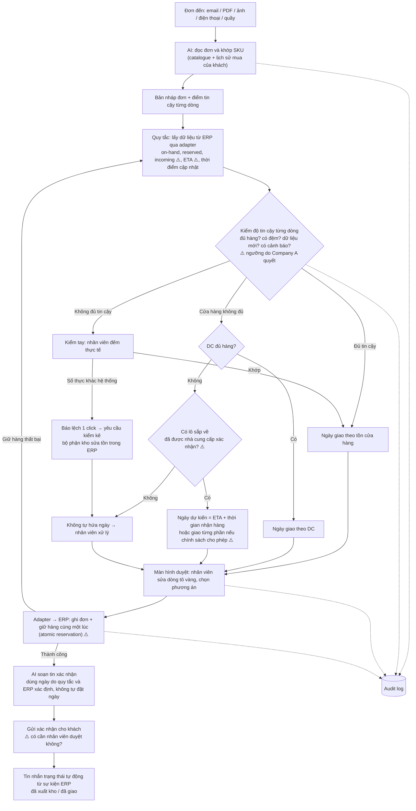

# Proposal OrderFlow – bản đầy đủ gửi team

> **Người soạn:** Hoàng (hofang) · **Ngày:** 20/10/2026 · **Trạng thái:** bản nội bộ để team thống nhất trước khi dựng slide nộp vòng 1 (hạn 22:00, 26/10/2026)
>
> **Tài liệu này gồm 4 phần:**
> - **Phần A – Proposal:** bài toán, chẩn đoán, lựa chọn, giải pháp, timeline, business case, lý do không chọn hướng khác, ưu điểm, nhược điểm, thiếu sót.
> - **Phần B – 8 vấn đề cần làm rõ:** B2C, tồn kho sai, ai phát hiện lệch kho, quyền truy cập dữ liệu của AI, kiểm tra độ tin cậy dữ liệu, hàng sắp nhập, nhiều khách tranh một lô hàng, phân chia trách nhiệm AI và hệ thống.
> - **Phần C – 30 câu hỏi Q&A** và câu trả lời.
> - **Phần D – Tổng hợp:** bảng căn cứ, câu hỏi cần hỏi team/stakeholder, sơ đồ luồng tổng thể, thuật ngữ.

## Cách đọc tài liệu này

**Nguồn "proposal gốc"** mà tài liệu này dựa vào:

| Mã | File | Nội dung |
|---|---|---|
| **[TQ]** | `OrderFlow-Tong-quan-bai-toan-va-giai-phap.md` | Tổng quan bài toán, giải pháp, 30 câu Q&A |
| **[DX]** | `de-xuat-giai-phap.md` | Phân tích chi tiết, business case, nguồn số liệu |
| **[PD]** | `Pitch-Deck-OrderFlow.md` | Nội dung 10 slide |

Ví dụ: **[TQ §5.1]** là mục 5.1 trong file tổng quan, **[PD S6]** là slide 6 trong pitch deck.

> ⚠️ File `OrderFlow-Proposal-Draft.pdf` là **bản nháp cũ**, vẫn còn live tracking ở Thụy Điển và chưa có assistive mode tuần 6. **Không dùng làm căn cứ.**

**Nhãn mức độ căn cứ** (bắt buộc ở Phần B):

| Nhãn | Ý nghĩa |
|---|---|
| 🟢 **Proposal nêu rõ** | Có câu chữ trực tiếp trong [TQ], [DX] hoặc [PD] |
| 🟡 **Suy luận / đề xuất triển khai** | Logic nghiệp vụ hoặc kỹ thuật hợp lý, nhưng **proposal chưa xác nhận**. Đây là gợi ý để team cân nhắc, **không phải thiết kế đã chốt** |
| 🔴 **Chưa được xác định** | Proposal không có đủ căn cứ; cần team hoặc khách hàng quyết |

**Ký hiệu số liệu:** **[A]** = giả định của team, cần kiểm chứng · **[V]** = số liệu do vendor tự công bố.

> **Lưu ý quan trọng:** OrderFlow **chưa được triển khai ở đâu cả**. Mọi mô tả "hệ thống làm X" trong tài liệu này đều là **thiết kế đề xuất**.

---

# PHẦN A – PROPOSAL

## A0. Tóm tắt trong 30 giây

Company A nên **ưu tiên Manual processes, cụ thể là khâu nhận đơn của nhà thầu (B2B)**.
- **Hiện tại:** đơn đến qua email, điện thoại, PDF; nhân viên gõ lại tay vào ERP và hứa ngày giao khi chưa kiểm tồn.
- **OrderFlow:** một lớp phần mềm mỏng có AI, đặt **trước** ERP hiện có. Lớp này đọc đơn, khớp mã hàng, kiểm tồn, rồi để nhân viên duyệt trên một màn hình.
- **Time to market:** cửa hàng pilot dùng được **từ tuần 6**, chưa cần sửa ERP.
- **Giá trị:** kịch bản cơ sở trả lại **≈55 FTE** thời gian cho bán hàng [A].
- **Mở rộng:** cùng một lõi, triển khai khác nhau ở Thụy Điển và Na Uy.

## A1. Bối cảnh cuộc thi

- **IT Consultant Challenge 2026** do Netcompany Vietnam và Code MeLy tổ chức, chủ đề *"Prompt to Production"*. Mỗi đội 3 người.
- Có 3 vòng loại trực tiếp:
  - **Vòng 1 (19–26/10):** nộp proposal PDF, tối đa 10 slide, tiếng Anh.
  - **Vòng 2 (2–9/11):** **chính team build MVP** trong 1 tuần, nộp kèm AI Journal.
  - **Vòng 3 (16–21/11):** nhận change request, demo và pitch trực tiếp. Chung kết ngày 21/11.
- **5 tiêu chí vòng 1:** Problem Understanding · Prioritisation & Critical Thinking · Business Impact · Feasible Solution · Structured Thinking & Innovation.
- **Quy định về AI:** được dùng, nhưng team phải hiểu, kiểm chứng và tự bảo vệ được mọi nội dung. Slide không được hoàn toàn do AI tạo.
- **Hệ quả:** ý tưởng phải vừa hợp lý với khách hàng, vừa **build được bởi 3 người trong 1 tuần**.

## A2. Bài toán của Company A

**Company A** là chuỗi bán lẻ vật liệu xây dựng của Đan Mạch:
- Hàng trăm cửa hàng ở **Đan Mạch, Na Uy, Thụy Điển**.
- Phục vụ cả **nhà thầu (B2B)** lẫn **khách lẻ (B2C)**.
- Bán vật liệu xây dựng, dụng cụ, đồ sửa nhà.
- Đề tóm lại: *"One business. Three markets. Different ways of working."*

**4 thách thức** (vì mỗi nước tự xây hệ thống và quy trình riêng):

| Thách thức | Ý nghĩa | Đề gợi ý (giữ nguyên chữ "may") |
|---|---|---|
| Manual processes | Nhiều việc làm tay, tốn công nhân viên | Đan Mạch: *may create the greatest impact* |
| Inconsistent operations | Mỗi cửa hàng một cách làm, trải nghiệm khách không đồng đều | Na Uy: *may be a more urgent priority* |
| Delivery & fulfilment | Đơn hàng và giao hàng kém hiệu quả, kém tin cậy | Thụy Điển: *may have greater business impact* |
| Fragmented systems | Hệ thống mỗi nước khác nhau, khó nhân rộng cải tiến | Cả ba nước |

**Ràng buộc của ban điều hành:**
- Chỉ đầu tư **một giải pháp số**, nhưng **không triển khai giống hệt** ở cả ba nước.
- Phải tính tới: quy trình địa phương, hệ thống sẵn có, nhu cầu vận hành, vận hành cửa hàng và kho, tác động lên nhân viên và khách hàng, cách rollout.
- **Time to market là then chốt.** Khoanh phạm vi cẩn thận, tập trung một vấn đề, tối đa hóa tác động.

**Nhiệm vụ của team:** Identify (chọn 1 cơ hội) → Prioritise (vì sao chọn) → Solve (giải pháp + MVP) → Scale (rollout có tính khác biệt địa phương). Ngoài ra phải trả lời *"AI tạo giá trị ở đâu?"*.

## A3. Chẩn đoán: gốc rễ nằm ở khâu nhận đơn

Đi theo một đơn hàng của nhà thầu, cả 4 thách thức đều xuất hiện:

```
1. Đơn đến       → email, điện thoại, PDF, ảnh; mỗi nước một kiểu    (Fragmented systems)
2. Gõ lại tay    → nhân viên nhập từng dòng vào ERP                  (Manual processes)
3. Xử lý         → mỗi cửa hàng xác nhận, gọi lại theo cách riêng    (Inconsistent operations)
4. Hứa & giao    → hứa ngày khi chưa kiểm tồn → giao trễ, thiếu      (Delivery & fulfilment)
```

**Gốc rễ:** Company A không có một lớp nhận đơn chung, có cấu trúc và có kiểm tồn, nằm trên ba ERP quốc gia. Vì vậy đơn nào cũng phải xử lý tay, và mọi cải tiến chỉ dừng ở cấp từng nước.

> Đây là **giả thuyết** suy ra từ đề, chưa có dữ liệu thật của Company A. Tuần 1–2 của pilot dùng để kiểm chứng.

## A4. Lựa chọn: Manual processes ở khâu nhận đơn của nhà thầu

> **"We prioritise Manual processes – specifically contractor order handling."**

- **Một vấn đề duy nhất:** đơn B2B được gõ lại tay và được hứa ngày giao khi chưa kiểm tồn.
- Sửa được khâu này thì **mở đường** cho 3 thách thức kia (lợi ích lan tỏa). Team **không** tuyên bố giải quyết cả 4.
- **Bắt đầu ở Đan Mạch:** đề gợi ý manual processes có thể có tác động lớn nhất ở đây, và đây có thể là nơi khối lượng làm tay cao nhất [A].
- **Khách hàng trọng tâm là B2B.** Lợi ích cho B2C được phân tích kỹ ở **Phần B, mục B1**.

## A5. Giải pháp: OrderFlow

### A5.1 Ý tưởng

OrderFlow là một **lớp phần mềm mỏng có AI**, đặt **trước** ERP hiện có của từng nước. **Không thay ERP** (mô hình *strangler fig*: thêm lớp mới phía trước rồi thay dần từng phần, không đập bỏ hệ thống cũ).

| Bước | Ai hoặc cái gì làm | Việc |
|---|---|---|
| 1. Đọc đơn | **AI** | Email, PDF hoặc ảnh → danh sách hàng, số lượng, công trình, ngày cần |
| 2. Khớp mã hàng | **AI** | Tên gọi kiểu dân trong nghề → mã SKU, dựa trên catalogue và lịch sử mua |
| 3. Kiểm tồn | **Quy tắc nghiệp vụ** | Tồn cửa hàng + kho trung tâm (DC) → ngày giao thực tế. Dòng tồn thấp → lấy ngày theo DC hoặc kiểm tay |
| 4. Duyệt | **Nhân viên** | Một màn hình; dòng AI không chắc được tô vàng |
| 5. Gửi & xác nhận | **API / adapter** | Adapter cho ERP từng nước; nhà thầu nhận ngày giao và tin nhắn trạng thái tự động từ sự kiện ERP |

*Nguồn: [TQ §5.1], [DX §3], [PD S6].*

### A5.2 AI tạo giá trị ở đâu

- **Hiểu đơn phi cấu trúc:** email, PDF, ảnh viết tay.
- **Khớp mã hàng:** xử lý tiếng lóng nghề (VD "45x95 C24") và ba ngôn ngữ (Đan Mạch, Na Uy, Thụy Điển).
- **Giai đoạn sau:** gợi ý mua kèm, dự báo rủi ro giao trễ.
- **Tin cậy:** model chạy trong EU/EEA, không train trên dữ liệu khách, có điểm tin cậy, người duyệt cuối và log kiểm toán.
- **EU AI Act:** đọc đơn hàng không phải ứng dụng rủi ro cao; người duyệt có mặt trong quy trình theo thiết kế.
- **AI nằm trong quy trình, không phải chatbot.**

### A5.3 Phạm vi

| ✅ Trong phạm vi | ❌ Ngoài phạm vi (năm 2, chưa tính chi phí) |
|---|---|
| AI đọc đơn email/PDF/ảnh, khớp SKU | Live GPS tracking, khung giờ giao |
| Kiểm tồn Store + DC → ngày giao | App tài xế, TMS, tối ưu tuyến |
| Màn hình duyệt (human-in-the-loop) | Portal/app tự đặt hàng cho nhà thầu |
| Adapter cho ERP từng nước | Thay hoặc hợp nhất ERP |
| Tin nhắn xác nhận + trạng thái tự động từ sự kiện ERP | AI gợi ý mua kèm, dự báo giao trễ |
| Counter mode (Na Uy) | Webshop, click & collect, mở rộng B2C qua email/điện thoại |

### A5.4 Timeline

**Giai đoạn 1 – Pilot Đan Mạch (12 tuần, 2 nấc):**

| Tuần | Việc | Kết quả |
|---|---|---|
| 1 | Integration spike: kiểm tra ERP Đan Mạch (API, import file, EDI); lấy 500 đơn cũ làm bộ test; kiểm giả định 20 đơn/ngày theo loại cửa hàng | Biết cách đưa đơn vào ERP |
| 2–5 | Xây phần AI đọc đơn, khớp mã, màn hình duyệt; back-test offline | Đo độ chính xác trước khi go-live |
| **6** | **Assistive mode ở 5–10 cửa hàng:** AI điền sẵn, nhân viên duyệt rồi nhập vào ERP như hiện nay (copy hoặc import) | **Có giá trị thật, chưa cần sửa ERP** |
| 7–10 | Adapter ghi đơn thẳng vào ERP; xác nhận cho nhà thầu kèm ngày giao | Bỏ bước copy tay |
| 11–12 | Đo KPI → **Gate 1: go/no-go** trước khi cấp vốn cho Thụy Điển và Na Uy | Quyết định dựa trên số liệu |

**Giai đoạn 2 – Mở rộng (tháng 4–12):**

| Thời gian | Nước | Điểm đau | Phần thêm vào lõi chung |
|---|---|---|---|
| Tháng 4–6 | 🇩🇰 Đan Mạch toàn quốc | Manual processes | Thêm kênh ảnh và ghi chú điện thoại |
| Tháng 5–9 | 🇸🇪 Thụy Điển | Delivery & fulfilment | Adapter ERP + ngày giao kiểm theo tồn Store + DC + tin nhắn trạng thái tự động từ sự kiện ERP |
| Tháng 8–12 | 🇳🇴 Na Uy | Store operations | Adapter ERP + **Counter mode** |

**Giai đoạn 3 – Năm 2 (tùy chọn, chưa tính chi phí):** live GPS tracking, khung giờ giao, portal nhà thầu, AI gợi ý mua kèm, dự báo rủi ro giao trễ, mở rộng B2C. Tất cả chạy trên cùng Order API.

> **Câu chốt về time to market:** *"First stores live in week 6, all of Denmark by month 6, all three markets within 12 months – no ERP replacement."*

### A5.5 KPI go/no-go của pilot [A]

| KPI | Mục tiêu |
|---|---|
| Đơn được duyệt mà không phải sửa | ≥ 60% |
| AI khớp đúng từng dòng hàng **trước khi duyệt** (back-test 500 đơn) | ≥ 95% |
| Lỗi đơn **sau khi duyệt** | ≤ 50% mức hiện tại |
| Thời gian xử lý mỗi đơn | −60% |
| Từ nhận đơn đến xác nhận cho khách | < 15 phút |
| Ngày giao đã hứa được giữ | +10 điểm % so với hiện tại |

- **Vì sao đo theo từng dòng:** nếu mỗi dòng đúng 90% thì một đơn 15 dòng chỉ đúng trọn khoảng 0,9¹⁵ ≈ 21%.
- **Vì sao phải back-test:** pha chạy thật chỉ có khoảng 1.500–3.000 đơn, nên KPI về lỗi được kiểm thêm trên 500 đơn cũ. Các tuần chạy thật dùng để xác nhận thời gian xử lý và mức độ nhân viên sử dụng.

### A5.6 Một giải pháp, ba cách triển khai

- **Dùng chung:** lõi AI, Order API, màn hình duyệt, mô hình dữ liệu.
- **Riêng từng nước:** adapter ERP, ngôn ngữ và thuật ngữ sản phẩm, quy tắc ngày giao, quy trình cửa hàng.
- **Con người:**
  - Tham vấn đại diện người lao động trước mỗi đợt triển khai (Đan Mạch: thỏa thuận hợp tác; Na Uy: Luật Môi trường làm việc, chương 8; Thụy Điển: MBL).
  - Mỗi nước có "store champion".
  - **Không cắt giảm nhân sự.**
- **Ghi chú phụ cho Na Uy:** e-invoicing B2B bắt buộc từ 01/01/2027. Đơn có cấu trúc giúp tuân thủ dễ hơn, nhưng **đây không phải lý do chính** để chọn giải pháp.

### A5.7 Prototype cho vòng 2 (team build trong 1 tuần)

- Hộp thư đơn mẫu: 10–20 email, PDF, ảnh danh sách vật tư giả lập.
- AI đọc đơn và trả về JSON có cấu trúc.
- Khớp mã trên catalogue mẫu 300–500 sản phẩm, có điểm tin cậy.
- Màn hình duyệt: đơn gốc bên trái, đơn đã đọc bên phải, dòng không chắc tô vàng.
- Bảng tồn kho giả theo cửa hàng → ngày giao dự kiến.
- Mock ERP với adapter DK/SE/NO cấu hình theo nước.
- Dashboard nhỏ: % đơn không phải sửa, thời gian xử lý, độ chính xác trên bộ test.
- **Kiến trúc chia module** để đón change request ở vòng 3.

## A6. Business case (kịch bản cơ sở; toàn bộ là [A])

**Công thức:** số cửa hàng × số đơn thủ công/ngày × số phút/đơn ÷ 60 × 250 ngày ÷ 1.650 giờ/FTE = số FTE đang gõ đơn. Sau đó × % thời gian giảm × hệ số hiện thực hóa = số FTE được giải phóng.

| Giả định [A] | Bi quan | **Cơ sở** | Lạc quan |
|---|---|---|---|
| Số cửa hàng | 300 | 300 | 300 |
| Đơn B2B thủ công / cửa hàng / ngày | 15 | **20** | 30 |
| Số phút / đơn | 6 | 8 | 8 |
| FTE đang gõ đơn | 68 | **121** | 182 |
| % thời gian giảm | 50% | 60% | 60% |
| Hệ số hiện thực hóa | 50% | 75% | 100% |
| **FTE được giải phóng** | **17** | **≈55** | **109** |
| Giá trị năng lực / năm (DKK) | 7m | **23m** | 49m |

**Từ giá trị năng lực sang tiền mặt** (kịch bản cơ sở):

| Bước | DKK / năm |
|---|---|
| Giá trị năng lực (≈55 FTE) | 23m |
| Phần quy ra tiền mặt [A]: bớt thuê thời vụ, giảm làm thêm giờ, không tuyển bù người nghỉ | ≈5,8m |
| Trừ chi phí vận hành (LLM, hạ tầng, hỗ trợ) [A] | −2,2m |
| **Tiền mặt ròng** | **≈3,6m** |

- **Hoàn vốn tiền mặt:** MVP (~DKK 4,5m) khoảng 15 tháng; toàn chương trình (≈2,5× MVP) khoảng 3 năm.
- **Chưa tính:** giữ chân nhà thầu nhờ xác nhận nhanh và giao đúng hẹn; lợi ích cho B2C.
- **Chi phí lương dùng để tính:** Đan Mạch ~DKK 450k/FTE, Na Uy và Thụy Điển ~DKK 370k/FTE, bình quân ~DKK 425k. Nguồn thứ cấp từ Danmarks Statistik, SSB, SCB; tỷ giá cần kiểm lại.
- **Benchmark [V]** (ngành lân cận, vendor tự công bố): OIKI (thép, IBM) giảm từ 30 xuống 12 phút/đơn; Topa (thiết bị vệ sinh, Lleverage) "+90% automated". **Chưa có benchmark độc lập nào của ngành vật liệu xây dựng.**

## A7. Vì sao không chọn những hướng khác

### A7.1 Không chọn thách thức khác làm trọng tâm

| Thách thức | Vì sao không chọn làm trọng tâm |
|---|---|
| **Delivery & fulfilment** (Thụy Điển) | Giao trễ thường bắt đầu từ lời hứa không kiểm tồn ở khâu nhận đơn. Làm tracking trước thì chỉ giúp khách *theo dõi* một lời hứa vốn đã sai. Tracking lại cần đội xe, TMS, app tài xế, mất nhiều tháng |
| **Inconsistent operations** (Na Uy) | Sửa nhanh được bằng app quản lý việc ở cửa hàng, nhưng đó chỉ là chuẩn hóa bề mặt. Na Uy vẫn được giải quyết ở wave 3 qua counter mode |
| **Fragmented systems** | Sửa tận gốc nghĩa là hợp nhất hoặc thay ERP, mất nhiều năm, nên trượt yêu cầu time to market |

### A7.2 Không chọn các phương án giải pháp khác

| Phương án | Tác động | Time to market | Vì sao loại |
|---|---|---|---|
| **A. OrderFlow (chọn)** | Cao | **Vài tuần** | Vừa nhanh vừa đánh vào gốc |
| B. Portal tự đặt hàng cho nhà thầu | Trung bình–cao | Chậm (phải chờ khách chấp nhận) | Cần giá và tồn kho chuẩn trước; nhà thầu vẫn quen gửi email. Để năm 2 |
| C. Chỉ khung giờ giao + tracking | Trung bình–cao | Nhiều tháng | Chạy được mà không cần A, nhưng giá trị bị giới hạn khi ngày giao vẫn được hứa không kiểm tồn. Chỉ có ích cho Thụy Điển |
| D. App quản lý việc ở cửa hàng | Thấp | Vài tuần | Nhanh nhưng chỉ mang tính bề mặt |
| E. Hợp nhất hoặc thay ERP | Cao | Nhiều năm | Đúng gốc nhưng quá chậm và rủi ro |

### A7.3 Vì sao bắt đầu ở Đan Mạch

- Đề gợi ý manual processes có thể có tác động lớn nhất ở Đan Mạch, đúng vấn đề team chọn.
- Đan Mạch là nơi đặt trụ sở: dễ tiếp cận stakeholder và dễ làm pilot [A].
- Thụy Điển cần dữ liệu đơn có cấu trúc và kiểm tồn **trước**; Đan Mạch sẽ tạo ra lõi đó. Thụy Điển bắt đầu từ tháng 5 trên cùng lõi.

### A7.4 Vì sao B2B trước, không phải B2C

- **Đơn thủ công tập trung ở B2B:** nhà thầu gửi danh sách vật tư tự do, còn khách lẻ phần lớn mua tại quầy hoặc qua webshop với mã hàng có sẵn [A].
- **Giá trị mỗi khách lớn hơn:** đơn lớn, mua lặp lại.
- **Hậu quả khi hỏng nặng hơn:** đội thợ ngồi chờ thì nhà thầu chuyển sang đối thủ.
- **Ngành cũng đi theo hướng này:** STARK Group nói chiến lược xoay quanh thợ và nhà thầu.

## A8. Ưu điểm

1. **Đúng một vấn đề, có lý do rõ ràng.** Bám yêu cầu "Choose ONE".
2. **Time to market nhanh.** Có giá trị thật từ tuần 6, chưa cần sửa ERP.
3. **Rủi ro thấp.** Không thay ERP; triển khai từng bước, có Gate 1 trước khi tốn thêm tiền.
4. **Tái sử dụng cao.** Một lõi cho ba nước, đúng tinh thần "reuse, not reinvent" của Netcompany.
5. **AI nằm trong quy trình và có kiểm soát.** Có người duyệt, chạy trong EU, có log.
6. **Trả lời được cả 4 thách thức theo thứ tự hợp lý:** Đan Mạch (manual) → Thụy Điển (delivery) → Na Uy (consistency), trên nền một lớp dữ liệu chung.
7. **Demo được ở vòng 2.**
8. **Thân thiện với người lao động.** Không cắt giảm nhân sự, có tham vấn công đoàn.

## A9. Nhược điểm và rủi ro

| Nhược điểm / rủi ro | Khả năng / Tác động | Cách giảm |
|---|---|---|
| ERP không có API ghi đơn | Trung bình / Cao | Assistive mode không cần đụng ERP; spike tuần 1; dùng file hoặc EDI |
| AI khớp sai tiếng lóng nghề | Trung bình / Trung bình | Người duyệt, ngưỡng tin cậy, back-test 500 đơn thật |
| Dữ liệu tồn kho không đúng | Cao / Trung bình | Dòng tồn thấp → lấy ngày theo DC hoặc kiểm tay; báo lệch kho bằng 1 click → kiểm kê (xem **B2, B3, B5**) |
| Tiền mặt ròng khiêm tốn (≈DKK 3,6m/năm) | — | Nói thật: giá trị chính là năng lực bán hàng và giữ chân khách; có Gate 1 để dừng sớm |
| Nhân viên hoặc công đoàn phản đối | Trung bình / Cao | Đồng thiết kế với cửa hàng pilot; định vị là công cụ hỗ trợ |
| Lo ngại về dữ liệu (GDPR) | Thấp / Cao | Chạy trong EU, có hợp đồng xử lý dữ liệu, không train trên dữ liệu khách (xem **B4**) |
| Chỉ phục vụ B2B là chính | — | Lựa chọn có chủ ý; nêu lợi ích B2C và đường mở rộng (xem **B1**) |
| Không xử lý khâu vận chuyển (xe, tuyến) | — | Ngoài phạm vi; để năm 2 |
| **Chưa có quy tắc cho hàng sắp nhập và giữ hàng** | Cao / Cao | **Chưa có trong proposal**, cần bổ sung (xem **B6, B7**) |

## A10. Thiếu sót: những gì team chưa biết hoặc chưa có

1. **Không có dữ liệu thật của Company A.** Số cửa hàng (300), số đơn mỗi ngày (20), số phút mỗi đơn (8) đều là giả định.
2. **Không có benchmark độc lập của ngành vật liệu xây dựng.** Các số "−60%", "90% tự động" đều do vendor công bố và đến từ ngành lân cận.
3. **Chưa biết Company A dùng ERP gì.** Đây là ẩn số lớn nhất về tính khả thi.
4. **Số tiền mặt** (DKK 5,8m quy đổi và 2,2m vận hành) là giả định, chưa có cơ sở chi tiết.
5. **Lợi ích về doanh thu và B2C chưa được định lượng.**
6. **Chưa phỏng vấn người trong ngành** (nhà thầu, nhân viên cửa hàng).
7. **Chưa có ảnh prototype.**
8. **Tỷ giá và lương** lấy từ nguồn thứ cấp.
9. 🆕 **Chưa có quy tắc tồn kho chi tiết:** ngưỡng "tồn thấp", độ mới của dữ liệu, cách xử lý hàng sắp nhập, cách giữ hàng giữa các đơn (xem B5–B7).
10. 🆕 **Chưa mô tả quyền truy cập dữ liệu của AI** (xem B4).
11. 🆕 **Mâu thuẫn câu chữ cần sửa:** proposal vừa ghi "AI học từ chỉnh sửa" [DX §7] [TQ Q17], vừa ghi "không train trên dữ liệu khách" [TQ §5.2] (xem B4).

---

# PHẦN B – 8 VẤN ĐỀ CẦN LÀM RÕ

> Mỗi mục có 5 phần: **1. Trả lời ngắn · 2. Logic từng bước · 3. Ví dụ minh họa · 4. Proposal đã nói gì / chưa nói gì · 5. Câu trả lời dùng trong Q&A.**
> Các ví dụ dùng **số minh họa**, không phải số thật của Company A.

## B1. Lợi ích cho B2C khi trọng tâm là B2B

### 1. Trả lời ngắn

B2C **chỉ hưởng lợi một phần, chủ yếu là gián tiếp**:
- **Gián tiếp:** thời gian nhân viên được giải phóng khỏi việc gõ đơn B2B có thể quay lại sàn bán. Tuy vậy, việc thời gian đó **có thật sự được dùng cho khách lẻ hay không** phụ thuộc vào cách cửa hàng quản lý.
- **Trực tiếp, nhưng hẹp:** ở Na Uy, counter mode chuẩn hóa cách nhận đơn tại quầy và qua điện thoại, cho cả khách lẻ.
- **Không thuộc phạm vi:** webshop, click & collect, app cho khách lẻ.
- **Không được định lượng:** "300 giờ/cửa hàng/năm" là **ước tính suy ra từ giả định**, chưa được xác thực.

### 2. Logic từng bước

**a) Lợi ích gián tiếp: thời gian quay lại sàn bán**
1. OrderFlow giảm thời gian gõ đơn B2B.
2. Nhân viên quầy có thêm thời gian.
3. **Nếu** cửa hàng bố trí lại công việc, thời gian đó dùng để tư vấn khách DIY, giảm hàng chờ ở quầy.
4. → B2C hưởng lợi. Tuy nhiên bước 3 là **điều kiện**, không tự động xảy ra.

**b) "300 giờ mỗi cửa hàng mỗi năm" nghĩa là gì**

| Bước tính | Giá trị | Loại |
|---|---|---|
| FTE được giải phóng (kịch bản cơ sở) | ≈55 FTE (54,5) | Suy ra từ 5 giả định [A] |
| × 1.650 giờ làm việc thực / FTE / năm | ≈90.000 giờ | Giả định [A] |
| ÷ 300 cửa hàng | **≈300 giờ / cửa hàng / năm** | Suy ra |
| ÷ 250 ngày làm việc | ≈1,2 giờ / cửa hàng / ngày | Suy ra |

- Đây là **tổng năng lực được giải phóng ở mỗi cửa hàng**, không phải "giờ dành riêng cho B2C".
- **Chưa được xác thực:** con số được xây trên 300 cửa hàng, 20 đơn/ngày, 8 phút/đơn, 60% thời gian giảm, 75% hiện thực hóa, đều là [A].
- **Thực tế sẽ phân bố không đều:** cửa hàng nhiều đơn B2B được giải phóng nhiều giờ hơn; cửa hàng thiên về DIY có thể gần như không được gì.
- **Theo kịch bản:** bi quan 17 FTE ≈ 95 giờ/cửa hàng/năm; lạc quan 109 FTE ≈ 600 giờ/cửa hàng/năm.

**c) Counter mode hỗ trợ B2C đến mức nào**
- **Định nghĩa trong proposal:** dùng cùng màn hình duyệt cho đơn tại quầy và qua điện thoại, để mọi cửa hàng Na Uy nhận, kiểm và xác nhận đơn theo cùng một cách.
- **Khách lẻ đặt tại quầy hoặc qua điện thoại** cũng đi qua quy trình chuẩn này: có kiểm tồn trước khi hứa ngày, được xác nhận theo cùng một cách ở mọi cửa hàng.
- **Giới hạn:**
  - Khách lẻ tại quầy thường mua hàng có sẵn trên kệ, với mã hàng rõ ràng, nên phần AI đọc đơn ít giá trị với họ. Giá trị chính là **sự nhất quán và kiểm tồn**.
  - Khách lẻ không có lịch sử mua, nên AI khớp mã chỉ dựa vào catalogue, kém chính xác hơn.
  - **Chỉ có ở Na Uy** theo timeline (tháng 8–12).
  - Proposal không nói counter mode có xử lý thanh toán, giá khuyến mãi hay trả hàng cho khách lẻ.

**d) Phần nằm ngoài phạm vi, chỉ là tùy chọn năm 2**
- Nhận đơn email hoặc điện thoại của khách lẻ làm dự án lớn (sửa cả nhà) qua cùng pipeline.
- Webshop, click & collect, app khách lẻ: **không có trong lộ trình**, kể cả năm 2.

### 3. Ví dụ minh họa (số giả định)

**Cửa hàng X ở Na Uy, sau khi có counter mode:**
- Một khách lẻ gọi điện đặt 30 bao xi măng giao tận nhà.
- **Trước:** nhân viên ghi giấy, hứa "thứ Năm" mà không kiểm tồn.
- **Sau:** nhân viên nhập vào màn hình chuẩn → quy tắc kiểm tồn → nếu đủ thì hứa thứ Năm; nếu không đủ thì đề xuất ngày theo DC → khách nhận xác nhận cùng mẫu với mọi cửa hàng khác.

**Lợi ích gián tiếp:** nếu cửa hàng X tiết kiệm được 1,2 giờ mỗi ngày nhờ không phải gõ đơn B2B, quản lý cửa hàng có thể dùng thời gian đó cho quầy tư vấn DIY vào giờ cao điểm. Đây là **quyết định của quản lý**, không phải tính năng của OrderFlow.

### 4. Proposal đã nói gì / chưa nói gì

| Nội dung | Nhãn | Căn cứ |
|---|---|---|
| Trọng tâm là B2B, B2C chỉ hưởng lợi một phần và gián tiếp | 🟢 | [TQ §0], [TQ §6.4] |
| 100% business case tính trên đơn B2B; lợi ích B2C không định lượng | 🟢 | [TQ §0] |
| Cách tính ≈300 giờ/cửa hàng/năm | 🟢 có công thức, nhưng **dựa trên toàn giả định [A]** | [TQ §0] |
| Counter mode = cùng màn hình cho đơn tại quầy và qua điện thoại | 🟢 | [TQ §11], [PD S9] |
| Counter mode phục vụ cả khách lẻ tại quầy | 🟢 | [TQ §0] |
| Thời gian được giải phóng chắc chắn được dùng cho khách lẻ | 🟡 **Có điều kiện**, phụ thuộc cách quản lý cửa hàng | Suy luận |
| Phân bố giờ theo loại cửa hàng | 🟡 Suy luận | Chưa có trong proposal |
| Counter mode xử lý thanh toán, khuyến mãi, trả hàng của B2C | 🔴 | Không có trong proposal |
| Mở rộng B2C qua email/điện thoại là tùy chọn năm 2 | 🟢 | [TQ §0], [TQ §5.3] |
| Webshop, click & collect, app B2C | 🟢 **Không giải quyết** | [TQ §0] |

### 5. Câu trả lời dùng trong Q&A

> *"B2B is our deliberate focus because that’s where free-text manual orders concentrate. Consumers benefit indirectly – our estimate, based on stated assumptions, is about 300 staff hours per store per year freed for the shop floor – and directly in Norway, where counter mode gives walk-in and phone orders the same checked process. Webshop and wider B2C channels are out of scope."*

## B2. Khi tồn kho trên hệ thống không đúng, ngày giao hứa có thể sai không?

### 1. Trả lời ngắn

**Có, vẫn có thể sai.** Phần mềm **không tự sửa được tồn kho thực tế**. Nó chỉ dùng số liệu tồn mà ERP hoặc hệ thống kho cung cấp. OrderFlow chỉ **giảm rủi ro** bằng cách:
1. Không hứa ngày theo tồn cửa hàng khi tồn thấp: lấy ngày theo DC hoặc chuyển sang kiểm tay.
2. Cho nhân viên báo lệch kho bằng 1 click, từ đó kích hoạt kiểm kê.

### 2. Logic từng bước

**Proposal nêu rõ (🟢):**
1. Quy tắc kiểm tồn cửa hàng và DC để tính ngày giao.
2. Dòng nào tồn thấp → lấy ngày theo DC hoặc kiểm tay.
3. Nhân viên báo lệch kho bằng 1 click → kích hoạt kiểm kê (cycle count).

**Luồng xử lý minh họa (🟡 đề xuất, proposal chưa mô tả chi tiết):**
1. Quy tắc đọc tồn khả dụng của cửa hàng.
2. Nếu tồn khả dụng **đủ và dữ liệu được đánh giá là đáng tin** (xem B5) → tính ngày theo cửa hàng.
3. Nếu **tồn thấp** → kiểm tồn khả dụng ở DC:
   - DC đủ hàng → ngày giao = thời gian chuyển hàng từ DC về cửa hàng hoặc tới công trường, cộng thời gian giao.
   - DC không đủ → **không tự động hứa ngày**; chuyển cho nhân viên kiểm tay.
4. **Kiểm tay** nghĩa là: nhân viên ra kệ hoặc bãi đếm thực tế, hoặc gọi kho, rồi xác nhận số lượng trước khi hứa.
5. Nếu nhân viên thấy số thực tế khác số trên hệ thống → bấm **"báo lệch"** → tạo yêu cầu kiểm kê cho mã hàng đó.
6. **Ai đếm, đếm trong bao lâu, ai sửa tồn trong ERP:** do quy trình kho hiện tại của Company A quyết định. OrderFlow **không tự sửa tồn**.

**"Kiểm kê" (cycle count)** là đếm lại một số mã hàng cụ thể, không phải đóng cửa để kiểm kê toàn bộ cửa hàng.

### 3. Ví dụ minh họa (số giả định)

- **Đơn hàng:** 40 tấm thạch cao giao thứ Hai.
- **Hệ thống báo:** cửa hàng có 45 tấm. **Thực tế trên kệ:** 25 tấm (một số tấm vỡ chưa được ghi nhận).
- **Không có OrderFlow:** nhân viên hứa thứ Hai → thứ Hai thiếu 15 tấm → đội thợ ngồi chờ.
- **Với OrderFlow:**
  - Nếu quy tắc coi 45 so với 40 là "đủ", hệ thống **vẫn có thể hứa sai**, vì nó không nhìn thấy kệ hàng.
  - Rủi ro chỉ giảm khi có thêm tín hiệu: tồn sát nhu cầu, dữ liệu cũ, hoặc nhân viên nghi ngờ (xem B3, B5). Khi đó dòng hàng được đánh dấu "cần kiểm tay" → nhân viên đếm được 25 → bấm "báo lệch" → cửa hàng kiểm kê → ngày giao tính lại theo DC.

→ **Kết luận:** OrderFlow **làm giảm** số lời hứa sai, nhưng **không loại bỏ** được hoàn toàn.

### 4. Proposal đã nói gì / chưa nói gì

| Nội dung | Nhãn | Căn cứ |
|---|---|---|
| Phần mềm không tự làm tồn kho đúng được | 🟢 | [TQ Q19] |
| Dòng tồn thấp → ngày theo DC hoặc kiểm tay | 🟢 | [TQ §5.1], [DX §3], [PD S6] |
| Báo lệch kho 1 click → kích hoạt kiểm kê | 🟢 | [TQ §8], [DX §7], [PD S10] |
| Rủi ro "dữ liệu tồn kho không đúng" được đánh giá Cao / Trung bình | 🟢 | [TQ §8], [PD S10] |
| Định nghĩa "tồn thấp" (ngưỡng cụ thể) | 🔴 | Không có |
| Cách tính ngày theo DC (thời gian vận chuyển, lịch chuyến) | 🔴 | Không có |
| Ai thực hiện kiểm kê, trong bao lâu, ai sửa tồn trong ERP | 🔴 | Không có |
| Báo lệch được gửi tới hệ thống nào (ERP, WMS hay danh sách việc của cửa hàng) | 🔴 | Không có |
| Luồng 6 bước ở mục 2 | 🟡 Đề xuất | Suy luận |

### 5. Câu trả lời dùng trong Q&A

> *"Yes, it can still be wrong – software can’t see the shelf. OrderFlow reduces the risk: low-stock lines get a DC-based date or a manual check, and staff can flag a mismatch in one click, which triggers a cycle count. Correcting the stock itself stays with Company A’s existing stock process."*

## B3. Ai hoặc điều gì phát hiện tồn kho bị lệch?

### 1. Trả lời ngắn

**Hệ thống không thể tự nhìn thấy hàng trên kệ.** Lệch kho chỉ được **phát hiện** qua tín hiệu, và chỉ được **xác nhận** khi có người đếm thực tế. Proposal hiện chỉ nêu **một kênh**: nhân viên bấm "báo lệch". Các tín hiệu tự động khác là đề xuất, chưa có trong proposal.

### 2. Logic từng bước

**Hai khái niệm cần tách bạch:**
- **Tín hiệu cảnh báo:** dấu hiệu cho thấy *có thể* lệch. Nó **không chứng minh** được là lệch.
- **Bằng chứng xác nhận:** kết quả đếm thực tế (kiểm kê), hoặc một sự kiện thực tế rõ ràng, ví dụ đi lấy hàng mà không thấy hàng.

**Các nguồn phát hiện:**

| Nguồn | Ai / cái gì | Loại | Nhãn |
|---|---|---|---|
| Nhân viên thấy kệ trống hoặc số thực khác số trên hệ thống, bấm "báo lệch" | Nhân viên | Tín hiệu mạnh, chưa phải xác nhận cuối | 🟢 có trong proposal |
| Lấy hàng thất bại: nhân viên kho đi lấy mà không đủ hàng | Nhân viên kho / ERP | Gần như bằng chứng | 🟡 đề xuất |
| Tồn rất thấp hoặc sát với lượng khách đặt | Quy tắc | Tín hiệu | 🟡 đề xuất (proposal chỉ nói "tồn thấp → DC/kiểm tay", chưa nói đây là tín hiệu lệch) |
| Dữ liệu tồn cũ: lần cập nhật gần nhất đã lâu | Quy tắc / dữ liệu đồng bộ | Tín hiệu | 🟡 đề xuất |
| Giao dịch bất thường: tồn âm, bán ra nhiều hơn tồn, điều chỉnh tồn nhiều lần | ERP / quy tắc | Tín hiệu | 🟡 đề xuất |
| Kiểm kê định kỳ hoặc theo yêu cầu | Nhân viên kho | **Bằng chứng xác nhận** | 🟡 quy trình hiện có của Company A (chưa biết) |

**Điều kiện để phát hiện và xác minh đáng tin cậy** (🟡 đề xuất):
1. ERP hoặc hệ thống kho **cung cấp được tồn kho kèm thời điểm cập nhật**, để biết dữ liệu mới hay cũ.
2. Giao dịch bán, xuất, nhập **được ghi kịp thời**. Nếu bán tại quầy mà cuối ngày mới nhập thì tồn luôn bị trễ.
3. Có **quy trình kiểm kê** với người chịu trách nhiệm và thời hạn rõ ràng.
4. Nút "báo lệch" phải **dễ bấm và có phản hồi**: nhân viên thấy yêu cầu của mình được xử lý thì mới tiếp tục báo.
5. Có **ghi nhận kết quả**: lệch bao nhiêu, mã hàng nào, cửa hàng nào. Từ đó xác định mã hàng hay bị lệch để đặt quy tắc chặt hơn.

### 3. Ví dụ minh họa (số giả định)

- **Mã hàng:** ván OSB 18mm, cửa hàng Y. Hệ thống báo 12 tấm, cập nhật lần cuối 3 ngày trước.
- **Tín hiệu:** dữ liệu đã cũ (tín hiệu 1); nhà thầu đặt 10 tấm, sát mức tồn (tín hiệu 2).
- → Quy tắc **không tự hứa ngày theo cửa hàng**, mà đánh dấu "cần kiểm tay".
- **Nhân viên ra bãi đếm:** 4 tấm → bấm "báo lệch" → tạo yêu cầu kiểm kê.
- **Bằng chứng:** kết quả kiểm kê xác nhận còn 4 tấm → bộ phận kho sửa tồn trong ERP.

→ Hai tín hiệu ban đầu chỉ là **lý do để kiểm**. Lần đếm thực tế mới là **bằng chứng**.

### 4. Proposal đã nói gì / chưa nói gì

| Nội dung | Nhãn | Căn cứ |
|---|---|---|
| Nhân viên báo lệch kho bằng 1 click → kích hoạt kiểm kê | 🟢 | [TQ §8], [DX §7], [PD S10] |
| Tín hiệu tự động (dữ liệu cũ, giao dịch bất thường, lấy hàng thất bại) | 🔴 Chưa có / 🟡 đề xuất | Không có trong proposal |
| Phân biệt tín hiệu và bằng chứng | 🟡 | Đề xuất |
| ERP có cung cấp thời điểm cập nhật tồn hay không | 🔴 | Chưa biết ERP của Company A |
| Quy trình kiểm kê hiện tại của Company A | 🔴 | Không có |

### 5. Câu trả lời dùng trong Q&A

> *"The system can’t see the shelf, so it only raises signals – today our design has one: staff flag a mismatch in one click. Signals like low or stale stock are reasons to check, not proof. Only a physical count confirms a mismatch, and Company A’s stock team corrects the ERP."*

## B4. AI được truy cập dữ liệu sâu đến mức nào?

### 1. Trả lời ngắn

Proposal chỉ nói AI **dùng catalogue sản phẩm và lịch sử mua** để khớp mã, chạy trong EU, không train trên dữ liệu khách, có người duyệt và audit log. Proposal **chưa mô tả quyền truy cập chi tiết**. Kiến trúc khuyến nghị là **least privilege** (quyền tối thiểu):
- AI **chỉ đọc** dữ liệu cần thiết qua API, **không truy cập trực tiếp database**.
- AI **chỉ tạo bản nháp**. Đơn chỉ vào ERP **sau khi nhân viên duyệt**, qua adapter.
- AI **không có quyền sửa tồn kho**.

### 2. Logic từng bước

**a) AI cần đọc những dữ liệu nào**

| Dữ liệu | Dùng để làm gì | Nhãn |
|---|---|---|
| Nội dung email, PDF, ảnh đơn hàng | Trích xuất hàng, số lượng, công trình, ngày cần | 🟢 [TQ §5.1] |
| Product catalogue (tên, mã SKU, quy cách, đơn vị, tên gọi khác) | Khớp tên gọi dân dã → SKU | 🟢 [TQ §5.1], [DX §3] |
| Lịch sử mua **của chính nhà thầu gửi đơn** | Ưu tiên mã mà khách đó hay mua | 🟢 có nhắc "lịch sử mua" [TQ §5.1]; 🟡 việc **giới hạn ở đúng khách đó** là đề xuất |
| Tồn kho, lượng đã giữ, hàng sắp nhập | **Không phải AI dùng**, mà là quy tắc nghiệp vụ dùng để tính ngày giao | 🟢 bước kiểm tồn là "Quy tắc" [TQ §5.1]; 🟡 tách khỏi AI là đề xuất |
| Giá hợp đồng, tín dụng của nhà thầu | Không cần cho việc đọc đơn và khớp mã; ERP tự áp giá khi nhận đơn | 🟡 đề xuất (proposal không nói) |

**b) Phân tách quyền (🟡 kiến trúc khuyến nghị)**

| Quyền | AI | Quy tắc nghiệp vụ / service | Nhân viên | ERP / adapter |
|---|---|---|---|---|
| Đọc email/PDF/ảnh đơn | ✅ | — | ✅ | — |
| Đọc catalogue, lịch sử mua liên quan | ✅ (qua API, chỉ đọc) | — | ✅ | Nguồn dữ liệu |
| Đọc tồn kho, ETA | ❌ (không cần) | ✅ (qua API, chỉ đọc) | ✅ | Nguồn dữ liệu |
| Tạo **bản nháp** đơn | ✅ | ✅ (thêm ngày giao) | ✅ (sửa) | — |
| **Duyệt** đơn | ❌ | ❌ | ✅ | — |
| **Ghi** đơn vào ERP | ❌ | ❌ | Kích hoạt bằng nút duyệt | ✅ adapter ghi sau khi duyệt |
| Giữ hàng (reservation) | ❌ | Gọi ERP | Kích hoạt | ✅ ERP là nơi ghi nhận (xem B7) |
| **Sửa tồn kho** | ❌ | ❌ | Chỉ **báo lệch** | ✅ chỉ qua quy trình kho hiện có |
| Gửi xác nhận cho khách | Soạn nội dung | Cung cấp ngày đã tính | Duyệt (nếu quy trình yêu cầu) | Phát sự kiện trạng thái |

**c) Vì sao không cho AI truy cập thẳng database**
- **Quyền tối thiểu:** AI chỉ thấy đúng dữ liệu mình cần, không thấy cả cơ sở dữ liệu.
- **Ổn định:** mỗi nước một ERP; adapter che đi sự khác biệt, nên AI không phải hiểu ba cấu trúc dữ liệu.
- **An toàn:** nếu AI bị lừa bởi nội dung độc hại trong email (prompt injection), nó vẫn không có quyền ghi hay sửa gì.
- **Kiểm soát được:** mọi lần đọc và ghi đều đi qua API nên ghi log được.

**d) Dữ liệu tối thiểu và audit log** (🟡)
- Chỉ gửi cho model phần nội dung cần thiết; giảm thông tin cá nhân (tên, số điện thoại) khi có thể.
- Log ghi lại: AI đề xuất gì, điểm tin cậy bao nhiêu, nhân viên sửa gì, ai duyệt, lúc nào.

**e) ⚠️ Mâu thuẫn cần sửa trong proposal**
- [DX §7] và [TQ Q17] ghi **"AI học từ chỉnh sửa"**, trong khi [TQ §5.2], [PD S6] ghi **"không train trên dữ liệu khách"**.
- **Cách hiểu đề xuất (🟡):** "học" nghĩa là **lưu lại cặp tên gọi → mã SKU** mà nhân viên đã sửa, vào bảng "tên gọi khác" (alias) trong catalogue nội bộ của Company A, để lần sau tìm đúng hơn. Việc này **không phải huấn luyện lại model AI**.
- **Cần team chốt câu chữ** trước khi lên slide, ví dụ: *"Staff corrections update Company A’s own product-alias list; the AI model is never trained on customer data."*

### 3. Ví dụ minh họa

- **Email:** *"Send 20 stk 45x95 C24 4,8m til Byggeplads Valby fredag"* (20 cây gỗ 45x95 C24, dài 4,8m, giao công trường Valby thứ Sáu).
- **AI đọc:** email + catalogue (các mã gỗ 45x95) + lịch sử mua của nhà thầu này (thường mua mã SKU-1234). → **Đề xuất** SKU-1234, số lượng 20, điểm tin cậy cao.
- **AI không đọc:** tồn kho, giá hợp đồng, đơn của nhà thầu khác.
- **Quy tắc** đọc tồn của SKU-1234 → tính ngày giao.
- **Nhân viên** duyệt → **adapter** ghi đơn vào ERP → ERP áp giá hợp đồng và giữ hàng.

### 4. Proposal đã nói gì / chưa nói gì

| Nội dung | Nhãn | Căn cứ |
|---|---|---|
| AI dùng catalogue và lịch sử mua để khớp mã | 🟢 | [TQ §5.1], [DX §3] |
| Model chạy trong EU, không train trên dữ liệu khách | 🟢 | [TQ §5.2], [PD S6] |
| Có điểm tin cậy, người duyệt, audit log | 🟢 | [TQ §5.2], [PD S6] |
| Nối với ERP qua Order API và adapter | 🟢 | [TQ §5.1], [DX §3] |
| Có hợp đồng xử lý dữ liệu, giảm tối thiểu dữ liệu cá nhân | 🟢 | [TQ Q21] |
| Bảng phân tách quyền chi tiết | 🟡 Kiến trúc khuyến nghị | Không có trong proposal |
| AI không truy cập trực tiếp database | 🟡 | Không có trong proposal |
| AI không có quyền sửa tồn kho | 🟡 | Không có trong proposal |
| Bảo vệ trước prompt injection | 🟡 | Không có trong proposal |
| "AI học từ chỉnh sửa" nghĩa là gì | 🔴 **Mâu thuẫn**, cần chốt | [DX §7], [TQ Q17] so với [TQ §5.2] |

### 5. Câu trả lời dùng trong Q&A

> *"The AI reads only what it needs – the order itself, the product catalogue and that customer’s purchase history – through APIs, never the database directly. It only creates drafts. Orders reach the ERP through an adapter after a staff member approves, and the AI has no right to change stock. Everything is logged, and the model is never trained on customer data."*

## B5. Kiểm tra "đủ dữ liệu để tin cậy" như thế nào?

### 1. Trả lời ngắn

Proposal **chưa định nghĩa quy tắc này**. Proposal chỉ nói "dòng tồn thấp → ngày theo DC hoặc kiểm tay". Dưới đây là **khung kiểm tra đề xuất** gồm 4 câu hỏi. Mọi ngưỡng số trong mục này là **ví dụ minh họa**, **không phải yêu cầu chính thức**. Ngưỡng thật cần chủ sở hữu sản phẩm và bộ phận kho của Company A quyết định.

### 2. Logic từng bước (🟡 khung đề xuất)

Với **mỗi dòng hàng**, quy tắc hỏi 4 câu:

| # | Câu hỏi | Dữ liệu cần | Nếu "không" |
|---|---|---|---|
| 1 | **Tồn khả dụng có đủ không?** (tồn khả dụng = hàng thực có − hàng đã giữ cho đơn khác; xem B6) | Tồn hiện có, lượng đã giữ | Kiểm DC hoặc cửa hàng khác |
| 2 | **Có đủ "khoảng đệm" không?** Lượng đặt có sát mức tồn không | Tồn khả dụng, lượng đặt | Coi là rủi ro → kiểm tay |
| 3 | **Dữ liệu có mới không?** Lần cập nhật gần nhất là khi nào | Thời điểm cập nhật tồn | Làm mới dữ liệu từ ERP; nếu vẫn cũ → kiểm tay |
| 4 | **Có cảnh báo nào đang mở không?** Báo lệch chưa xử lý, giao dịch chưa ghi nhận, tồn âm | Danh sách báo lệch, nhật ký giao dịch | Kiểm tay |

**Kết quả ba mức (đề xuất):**

| Mức | Điều kiện | Hành động |
|---|---|---|
| 🟢 **Đủ tin cậy** | Cả 4 câu đều "có" | Dùng tồn cửa hàng để tính ngày giao |
| 🟡 **Cần kiểm thêm** | Câu 1 "không" nhưng DC đủ hàng; hoặc câu 3 "không" nhưng làm mới xong thì đạt | Lấy ngày theo DC, hoặc làm mới dữ liệu rồi kiểm lại |
| 🔴 **Không đủ tin cậy** | Câu 2 hoặc câu 4 "không", hoặc DC cũng không đủ | **Không tự hứa ngày**; chuyển nhân viên kiểm tay |

**Vì sao các điều kiện này chỉ tăng độ tin cậy, không bảo đảm chính xác:**
- Dữ liệu mới và không có cảnh báo vẫn có thể sai, ví dụ hàng vỡ hoặc mất chưa ai phát hiện.
- Hệ thống chỉ biết những gì được ghi lại. **Chỉ có đếm thực tế mới là bằng chứng** (xem B3).
- Vì vậy khung này **giảm số lời hứa sai**, chứ không đưa số đó về 0. Proposal đo mức cải thiện bằng KPI "ngày giao đã hứa được giữ +10 điểm %".

**Ví dụ ngưỡng — CHỈ MINH HỌA, KHÔNG PHẢI THIẾT KẾ:**
- "Dữ liệu mới" = cập nhật trong vòng X giờ.
- "Khoảng đệm" = tồn khả dụng ≥ lượng đặt + Y% hoặc + Z đơn vị.
- Các giá trị X, Y, Z **phải do Company A quyết định**, và có thể khác nhau theo nhóm hàng (VD gỗ ngoài bãi thường lệch nhiều hơn đinh vít đóng hộp) và theo nước.

### 3. Ví dụ minh họa (số giả định)

| Dòng hàng | Tồn khả dụng | Đặt | Cập nhật | Cảnh báo mở | Kết quả |
|---|---|---|---|---|---|
| Vít gỗ 5x60 (hộp) | 200 | 10 | 1 giờ trước | Không | 🟢 Dùng tồn cửa hàng |
| Thạch cao 13mm | 45 | 40 | 1 giờ trước | Không | 🔴 Sát mức tồn → kiểm tay |
| Ván OSB 18mm | 12 | 10 | 3 ngày trước | Không | 🟡 Làm mới dữ liệu; nếu vẫn cũ → kiểm tay |
| Gỗ 45x95 C24 | 5 | 20 | 1 giờ trước | Không | 🟡 Cửa hàng không đủ → kiểm DC; DC có 300 → ngày theo DC |
| Xi măng 25kg | 80 | 30 | 1 giờ trước | **Có** báo lệch chưa xử lý | 🔴 Kiểm tay |

### 4. Proposal đã nói gì / chưa nói gì

| Nội dung | Nhãn | Căn cứ |
|---|---|---|
| Kiểm tồn cửa hàng và DC là việc của quy tắc | 🟢 | [TQ §5.1], [PD S6] |
| Dòng tồn thấp → ngày theo DC hoặc kiểm tay | 🟢 | [TQ §5.1], [DX §3] |
| KPI "ngày giao đã hứa được giữ +10 điểm %" | 🟢 [A] | [DX §4], [PD S7] |
| Khung 4 câu hỏi và ba mức tin cậy | 🟡 Đề xuất | Không có trong proposal |
| Ngưỡng "tồn thấp", độ mới dữ liệu, khoảng đệm | 🔴 | Không có; ví dụ X/Y/Z ở trên **chỉ để minh họa** |
| ERP có cung cấp thời điểm cập nhật tồn hay không | 🔴 | Chưa biết |

### 5. Câu trả lời dùng trong Q&A

> *"We check each line against four questions: is there enough available stock, is there a buffer, is the data fresh, and is there any open mismatch flag. Only when all pass do we promise from store stock; otherwise we use the DC date or a manual check. The exact thresholds are a business decision for Company A. This raises confidence – it can’t guarantee the shelf matches the system."*

## B6. Hàng sắp nhập kho và đơn khách mới đặt

**Ví dụ:** tồn thực tế 20 · lô đang chờ nhập 100 · khách mới đặt 50.

### 1. Trả lời ngắn

**Proposal chưa đề cập hàng sắp nhập (incoming stock).** Nguyên tắc đề xuất: **không bao giờ cộng hàng sắp nhập vào tồn hiện có** như thể hàng đã sẵn sàng giao. Với ví dụ trên, hôm nay chỉ có **tối đa 20 sản phẩm** để hứa giao (nếu chưa ai giữ). 30 sản phẩm còn lại chỉ có thể hứa **sau khi hàng về**, và chỉ khi lô hàng **được nhà cung cấp xác nhận** với ETA đáng tin cậy.

### 2. Logic từng bước (🟡 đề xuất)

**a) Bốn khái niệm tồn kho**

| Khái niệm | Nghĩa | Ví dụ |
|---|---|---|
| `on-hand stock` | Hàng **thực tế đang có** trong cửa hàng hoặc kho | 20 |
| `reserved stock` | Hàng **đã giữ cho đơn khác**, chưa giao | 0 (giả sử) |
| `available stock` | Hàng **khả dụng để hứa ngay** = on-hand − reserved | 20 − 0 = **20** |
| `incoming stock` | Hàng **đang trên đường về**, chưa nhập kho | 100 |

→ Nếu đã có đơn khác giữ 5 sản phẩm thì available = 20 − 5 = **15**, không phải 20.

**b) Trước khi dùng hàng sắp nhập để hứa, cần kiểm**
1. **Trạng thái đơn mua hàng (PO):** đã gửi hay chưa; **nhà cung cấp đã xác nhận** hay chưa.
2. **ETA (ngày dự kiến về):** do nhà cung cấp xác nhận hay chỉ là ước tính.
3. **Độ tin cậy của ETA:** nhà cung cấp này có hay giao trễ không (cần dữ liệu lịch sử).
4. **Thời gian nhận và kiểm hàng:** hàng về kho rồi còn phải kiểm, nhập hệ thống, chuyển về cửa hàng. Bước này mất thêm thời gian.
5. **Hàng sắp nhập đã bị đơn khác "giữ chỗ" chưa** (xem B7).

**c) Khi nào được và không được hứa**

| Tình huống | Có hứa ngày theo lô sắp về không? |
|---|---|
| PO đã được nhà cung cấp xác nhận, ETA đáng tin cậy | ✅ Có thể. Ngày giao = ETA + thời gian nhận/kiểm + thời gian giao. **Nên báo khách là ngày dự kiến** |
| PO đã gửi nhưng nhà cung cấp chưa xác nhận | ❌ Không hứa ngày cụ thể. Báo "đang chờ xác nhận", nhân viên liên hệ lại |
| Chỉ có kế hoạch đặt hàng, chưa có PO | ❌ Không hứa |
| ETA thường xuyên bị trễ | ⚠️ Chỉ hứa kèm khoảng an toàn, **khoảng an toàn do Company A quyết định**, hoặc không hứa |

**d) Nếu khách cần hàng ngay: các phương án** (tùy chính sách của Company A)
1. **Lấy từ DC hoặc cửa hàng khác** nếu nơi đó còn available đủ 50 → giao ngay.
2. **Giao từng phần** (nếu chính sách và khách đồng ý): 20 giao ngay, 30 giao sau khi lô về. Có thể phát sinh thêm chi phí giao lần hai.
3. **Giao một lần sau khi hàng về**, nếu khách chờ được.
4. **Đề xuất sản phẩm thay thế** tương đương, nếu khách đồng ý.

### 3. Ví dụ minh họa (số giả định)

- **Đơn:** nhà thầu đặt 50 tấm thạch cao, cần thứ Hai.
- **Cửa hàng:** on-hand 20, reserved 0 → available 20.
- **Lô sắp về:** 100 tấm. PO đã được nhà cung cấp xác nhận, ETA thứ Tư. Nhận và kiểm mất thêm 1 ngày.
- **DC:** available 0.

**Kết quả quy tắc đưa ra cho nhân viên:**
- ❌ **Sai:** "20 + 100 = 120 ≥ 50 → giao đủ thứ Hai."
- ✅ **Đúng:** "Thứ Hai giao được tối đa 20. 30 còn lại sớm nhất thứ Năm (ETA thứ Tư + 1 ngày nhận hàng)."
- **Phương án cho khách:** (a) nhận 20 vào thứ Hai và 30 vào thứ Năm, nếu cho phép giao từng phần; hoặc (b) nhận đủ 50 vào thứ Năm.
- **Nếu PO chưa được xác nhận:** chỉ hứa 20 vào thứ Hai; 30 còn lại "nhân viên sẽ xác nhận ngày sau".

### 4. Proposal đã nói gì / chưa nói gì

| Nội dung | Nhãn | Căn cứ |
|---|---|---|
| Kiểm tồn cửa hàng và DC trước khi hứa ngày | 🟢 | [TQ §5.1] |
| Hàng sắp nhập (incoming), PO, ETA của nhà cung cấp | 🔴 | **Không có** trong [TQ], [DX], [PD] |
| Khái niệm on-hand / reserved / available | 🔴 | Không có; định nghĩa ở trên là 🟡 đề xuất |
| Giao từng phần | 🔴 | Không có; cần chính sách của Company A |
| Thời gian nhận và kiểm hàng | 🔴 | Không có |
| ERP của Company A có quản lý PO và ETA không | 🔴 | Chưa biết |

### 5. Câu trả lời dùng trong Q&A

> *"We never add incoming stock to what’s on the shelf. With 20 on hand, 100 incoming and an order for 50, we can promise 20 now. The other 30 get a date only if the supplier has confirmed the delivery – and then it’s the arrival date plus receiving time. If the customer needs everything now, staff can check the DC or another store, or offer a split delivery if policy allows. Rules for incoming stock aren’t in our proposal yet – they’re a decision we’d agree with Company A."*

## B7. Nhiều khách cùng đặt hàng từ một lô sắp về

**Ví dụ:** lô sắp về 100 · ba khách lần lượt đặt 50, 40, 30 · tổng nhu cầu 120 > 100.

### 1. Trả lời ngắn

**Proposal chưa có cơ chế giữ hàng (reservation) và quy tắc phân bổ.** Để không hứa cùng một lượng hàng cho nhiều khách, mỗi lời hứa phải đi kèm **việc giữ hàng ngay lúc hứa**, trong một bước không chia cắt được (**atomic reservation**). Việc giữ hàng nên được ghi ở **ERP**, nguồn sự thật duy nhất, không ghi riêng trong OrderFlow. **Thứ tự ưu tiên giữa các khách là quyết định nghiệp vụ**, cần chủ sở hữu sản phẩm của Company A xác nhận.

### 2. Logic từng bước

**a) Vấn đề:** nếu chỉ "nhìn" số tồn mà không "giữ", cả ba nhân viên cùng thấy "100 sắp về" và cùng hứa đủ hàng. Kết quả là ba lời hứa trên 120 sản phẩm trong khi chỉ có 100.

**b) Các khái niệm**
- **Reserved quantity:** lượng đã giữ cho từng đơn. Lượng còn lại để hứa = lô − tổng đã giữ.
- **Allocation rules:** quy tắc chia hàng khi không đủ: ai đến trước được trước, hay ưu tiên theo loại khách, theo ngày cần.
- **Trạng thái xác nhận đơn:** đơn **nháp** (chưa giữ hàng), **đã giữ hàng tạm**, **đã xác nhận với khách**. Chỉ đơn đã giữ hàng mới được hứa ngày.

**c) Atomic reservation, giải thích dễ hiểu**
- Giống **đặt chỗ ngồi cuối cùng trên máy bay**: "kiểm còn chỗ" và "giữ chỗ" phải xảy ra **cùng một lúc**, như một thao tác duy nhất.
- Nếu hai nhân viên bấm cùng lúc, **chỉ một người giữ được**. Người kia thấy ngay con số đã giảm và phải chọn phương án khác.
- Nếu tách thành hai bước "nhìn" rồi mới "giữ", có một khoảng hở để hai người cùng thấy "còn hàng".
- Về kỹ thuật, việc này thường do **ERP hoặc hệ thống kho** đảm nhận (giao dịch cơ sở dữ liệu, khóa bản ghi). OrderFlow chỉ **gọi** ERP để giữ hàng và **nhận kết quả** thành công hoặc thất bại (🟡 đề xuất).

**d) ⚠️ Điểm rủi ro riêng của assistive mode (tuần 6–10)**
- Ở assistive mode, OrderFlow **chưa ghi vào ERP**. Nhân viên tự nhập đơn vào ERP sau khi duyệt.
- Nghĩa là từ lúc AI tạo bản nháp đến lúc nhân viên nhập vào ERP, **hàng chưa được giữ**.
- **Đề xuất (🟡):** trong assistive mode, **không gửi ngày giao cho khách cho tới khi đơn đã được nhập vào ERP** và ERP xác nhận đã giữ hàng. Điều này khớp với timeline: tự động xác nhận kèm ngày giao chỉ có từ tuần 7–10 [TQ §5.3].

### 3. Ví dụ minh họa (số giả định)

Lô 100 tấm, PO đã xác nhận. Ba đơn đến theo thứ tự:

**Nếu Company A chọn "đến trước được trước"** (chỉ là MỘT phương án, chưa được chọn):

| Đơn | Đặt | Còn lại trước khi giữ | Kết quả |
|---|---|---|---|
| Khách 1 | 50 | 100 | Giữ 50 → còn 50 |
| Khách 2 | 40 | 50 | Giữ 40 → còn 10 |
| Khách 3 | 30 | 10 | Chỉ giữ được 10. 20 còn lại: kiểm DC hoặc cửa hàng khác, giao từng phần, hoặc chờ lô sau |

**Nếu Company A chọn "ưu tiên ngày cần sớm nhất"**, kết quả có thể khác: khách 3 cần hàng sớm nhất thì được giữ trước.

→ **Team không tự chọn chính sách nào.** Bảng trên chỉ minh họa rằng **cách chia khác nhau thì kết quả khác nhau**.

**Có nên giữ lại một phần lô làm "đệm"?** Ví dụ chỉ cho hứa 90/100 phòng khi lô về thiếu hoặc hỏng. Đây cũng là **quyết định của Company A**.

### 4. Proposal đã nói gì / chưa nói gì

| Nội dung | Nhãn | Căn cứ |
|---|---|---|
| Cơ chế giữ hàng (reservation) | 🔴 | **Không có** trong proposal |
| Quy tắc phân bổ khi thiếu hàng | 🔴 | Không có |
| Atomic reservation ở ERP | 🟡 Đề xuất | — |
| Không gửi ngày giao trong assistive mode khi chưa giữ hàng ở ERP | 🟡 Đề xuất | Khớp timeline [TQ §5.3] nhưng proposal chưa nói rõ |
| ERP của Company A có hỗ trợ giữ hàng trên hàng sắp nhập không | 🔴 | Chưa biết |

**Quyết định nghiệp vụ cần chủ sở hữu sản phẩm của Company A xác nhận:**
1. Có cho phép hứa ngày dựa trên hàng sắp nhập không? Chỉ khi PO đã được xác nhận?
2. Thứ tự ưu tiên khi thiếu hàng: đến trước được trước, theo ngày cần, theo loại khách (nhà thầu có hợp đồng), hay theo giá trị đơn?
3. Giữ hàng tạm bao lâu thì tự hủy nếu khách không xác nhận?
4. Có giữ lại phần đệm của lô hàng không? Bao nhiêu?
5. Có cho phép giao từng phần không? Ai chịu chi phí giao thêm?
6. Có được lấy hàng từ cửa hàng khác hoặc DC không, và ai quyết?
7. Khi lô về thiếu hoặc trễ, ưu tiên đơn nào và ai báo cho khách?

### 5. Câu trả lời dùng trong Q&A

> *"A promise must hold stock at the same moment it’s made – an atomic reservation in the ERP, like booking the last seat on a plane – so 100 units can never be promised as 120. How to split stock when demand exceeds supply – first come, earliest need or contract customers – is a business rule we’d agree with Company A, not one we’d pick for them."*

## B8. Phân chia trách nhiệm giữa AI và hệ thống

### 1. Trả lời ngắn

**AI đọc và đề xuất. Quy tắc nghiệp vụ tính toán. ERP là nguồn sự thật. Nhân viên quyết định.**
- AI **không tự tính hay bịa ngày giao**. AI chỉ diễn đạt kết quả mà quy tắc đã tính.
- Proposal đã nêu 5 bước với vai trò AI / quy tắc / nhân viên / API ([TQ §5.1]). Luồng chi tiết dưới đây là **kiến trúc đề xuất** bổ sung cho 5 bước đó.

### 2. Logic từng bước (🟡 kiến trúc đề xuất, mở rộng từ 5 bước trong proposal)

| # | Bước | Ai chịu trách nhiệm | Đầu ra | Ghi chú căn cứ |
|---|---|---|---|---|
| 1 | Đọc email/PDF/ảnh; trích xuất hàng, số lượng, địa điểm, ngày cần; khớp SKU | **AI** | Bản nháp đơn + điểm tin cậy từng dòng | 🟢 [TQ §5.1] bước 1–2 |
| 2 | Cung cấp tồn hiện có, lượng đã giữ, hàng sắp nhập, ETA, thời điểm cập nhật | **Inventory service / ERP** (qua adapter) | Số liệu tồn kho | 🟢 có kiểm tồn Store + DC; 🔴 hàng sắp nhập và lượng đã giữ chưa có |
| 3 | Tính lượng đáp ứng được, kiểm độ tin cậy dữ liệu (B5), tính ngày giao khả thi | **Quy tắc nghiệp vụ** | Ngày giao đề xuất + mức tin cậy 🟢🟡🔴 | 🟢 bước 3 là "Quy tắc"; 🟡 khung kiểm tra chi tiết |
| 4 | Dữ liệu không đủ tin cậy → làm mới dữ liệu, kiểm DC, hoặc chuyển kiểm tay | **Quy tắc** chuyển việc → **Nhân viên** xác minh | Số lượng đã xác minh hoặc báo lệch | 🟢 "DC hoặc kiểm tay", "báo lệch 1 click" |
| 5 | Duyệt bản nháp: sửa dòng tô vàng, chọn phương án (giao từng phần, DC...) | **Nhân viên** | Đơn đã duyệt | 🟢 [TQ §5.1] bước 4 |
| 6 | Ghi đơn vào ERP và **giữ hàng trong cùng một thao tác** | **Adapter → ERP** | Mã đơn ERP, xác nhận đã giữ hàng | 🟢 adapter ghi ERP; 🔴 giữ hàng chưa có |
| 7 | Soạn tin nhắn xác nhận **dựa trên ngày mà quy tắc đã tính và ERP đã xác nhận** | **AI** soạn câu chữ; **không tự đặt ngày** | Nội dung tin nhắn | 🟡 đề xuất |
| 8 | Gửi xác nhận; gửi tin nhắn trạng thái khi ERP phát sự kiện (đã xuất kho, đã giao) | **Hệ thống**, nhân viên duyệt nếu quy trình yêu cầu | Tin nhắn cho khách | 🟢 "tin nhắn trạng thái tự động từ sự kiện ERP" |
| 9 | Ghi log toàn bộ: AI đề xuất gì, quy tắc tính gì, nhân viên sửa gì, ai duyệt | **Hệ thống** | Audit log | 🟢 có audit log |

**Ranh giới trách nhiệm:**

| Thành phần | Được làm | Không được làm |
|---|---|---|
| **AI** | Đọc đơn, khớp mã, chấm điểm tin cậy, soạn câu chữ | Tính ngày giao, giữ hàng, ghi ERP, sửa tồn, tự gửi khi chưa được duyệt |
| **Quy tắc nghiệp vụ** | Tính lượng đáp ứng, kiểm độ tin cậy, tính ngày giao, chuyển việc kiểm tay | Tự sửa tồn, tự quyết khi dữ liệu ở mức 🔴 |
| **ERP / hệ thống kho** | Nguồn sự thật về tồn, giữ hàng, đơn, giá, sự kiện trạng thái | — |
| **Nhân viên** | Duyệt đơn, xác minh tồn, báo lệch, chọn phương án với khách | — (chịu trách nhiệm cuối cùng, như hiện nay) |

### 3. Ví dụ minh họa

- **Email:** "50 tấm thạch cao 13mm, giao công trường Valby thứ Hai."
1. **AI:** SKU-2210, 50 tấm, Valby, thứ Hai, điểm tin cậy cao.
2. **ERP:** on-hand 20, reserved 0, sắp nhập 100 (PO đã xác nhận, ETA thứ Tư), cập nhật 1 giờ trước.
3. **Quy tắc:** available 20 < 50 → không đủ; DC = 0; lô sắp về hợp lệ → đề xuất "20 thứ Hai + 30 thứ Năm" hoặc "50 thứ Năm". Mức 🟡.
4. **Nhân viên:** gọi khách → khách chọn giao từng phần → duyệt.
5. **Adapter → ERP:** ghi đơn, giữ 20 hàng hiện có và 30 trên lô sắp về (nếu ERP hỗ trợ) → thành công.
6. **AI soạn tin:** *"Đơn của anh đã nhận: 20 tấm giao thứ Hai, 30 tấm giao thứ Năm."* Hai ngày này lấy từ quy tắc và ERP, **AI không tự nghĩ ra**.
7. **Hệ thống** gửi tin, ghi log.

### 4. Proposal đã nói gì / chưa nói gì

| Nội dung | Nhãn | Căn cứ |
|---|---|---|
| 5 bước: AI đọc → AI khớp mã → Quy tắc kiểm tồn → Nhân viên duyệt → API gửi | 🟢 | [TQ §5.1], [PD S6] |
| Tin nhắn trạng thái tự động từ sự kiện ERP | 🟢 | [DX §3], [PD S9] |
| Người duyệt cuối, audit log | 🟢 | [TQ §5.2] |
| AI không tự đặt ngày giao, chỉ diễn đạt kết quả | 🟡 | Đề xuất; hợp với việc bước 3 là "Quy tắc" |
| Luồng 9 bước, bước làm mới dữ liệu, bước giữ hàng | 🟡 | Đề xuất |
| Ai duyệt tin nhắn trước khi gửi | 🔴 | Không có |

### 5. Câu trả lời dùng trong Q&A

> *"AI reads and suggests; business rules calculate; the ERP is the source of truth; staff decide. The AI never invents a delivery date – it only words the date the rules calculated and the ERP confirmed. Every step is logged."*

---

# PHẦN C – 30 CÂU HỎI Q&A

> Mỗi câu gồm **Vì sao bị hỏi** (nếu cần), **Trả lời** và **EN** (câu nói gọn khi pitch).
> Nguyên tắc: trả lời thẳng trong 1 câu rồi mới giải thích; số liệu nào là giả định thì nói luôn là giả định.
> Các câu liên quan tới Phần B có ghi chú để đọc thêm.

### C1. Hiểu vấn đề

**Q1. Giải pháp này chỉ phục vụ B2B à? Còn B2C thì sao?** *(xem B1)*
- *Vì sao bị hỏi:* đề nói Company A phục vụ cả hai nhóm khách.
- *Trả lời:* Trọng tâm là B2B, và đó là lựa chọn có chủ ý vì đơn làm tay tập trung ở nhà thầu. B2C hưởng lợi gián tiếp: ước tính khoảng 300 giờ mỗi cửa hàng mỗi năm được giải phóng (dựa trên giả định). B2C còn hưởng lợi trực tiếp ở Na Uy nhờ counter mode. Mở rộng cho đơn email hoặc điện thoại của khách lẻ là tùy chọn năm 2. Webshop nằm ngoài phạm vi.
- *EN:* "B2B is a deliberate choice – that’s where free-text, manual orders concentrate. Consumers gain an estimated 300 staff hours per store per year, and Norway’s counter mode serves walk-in consumers too."

**Q2. Làm sao biết khâu nhận đơn là gốc rễ, khi chưa có dữ liệu của Company A?**
- *Trả lời:* Đây là giả thuyết suy ra từ đề: 4 thách thức đều xuất hiện trên đường đi của một đơn hàng. Tuần 1–2 của pilot dùng để kiểm chứng: đo số đơn làm tay, thời gian mỗi đơn, tỷ lệ ngày hứa bị trễ.
- *EN:* "It’s a hypothesis built from the brief – all four challenges show up in one order. Weeks 1–2 of the pilot measure it before we scale."

**Q3. Sao không khảo sát người dùng?**
- *Trả lời:* Thời gian vòng 1 có hạn và team không tiếp cận được Company A. Nếu kịp, team phỏng vấn 3–5 người trong ngành. Trong pilot, việc đầu tiên là ngồi cùng nhân viên quầy để quan sát.
- *EN:* "Discovery with store staff is week 1 of the pilot; we validate before we build further."

**Q4. Các bạn giải 1 hay giải cả 4 thách thức?**
- *Trả lời:* Giải **một**: Manual processes ở khâu nhận đơn của nhà thầu. 3 thách thức kia được cải thiện như hệ quả, không phải mục tiêu chính, và không nằm trong business case.
- *EN:* "One problem: manual contractor order handling. The other three benefit as a knock-on effect, not as our target."

### C2. Ưu tiên và tư duy phản biện

**Q5. Đề gợi ý Thụy Điển có thể có business impact lớn nhất. Sao không bắt đầu ở đó?**
- *Trả lời:* Giao trễ thường bắt đầu từ lời hứa không kiểm tồn ở khâu nhận đơn. Team sửa khâu nhận đơn ở Đan Mạch trước, rồi dùng lại lõi đó ở Thụy Điển từ tháng 5.
- *EN:* "Late deliveries start with unchecked promises at intake. We fix intake first and reuse the core in Sweden from month 5."

**Q6. Sao không làm tracking giao hàng như Travis Perkins, STARK UK?**
- *Trả lời:* Tracking là một hệ thống khác hẳn (GPS, TMS, app tài xế), mất nhiều tháng. Không có kiểm tồn thì tracking chỉ giúp theo dõi một lời hứa vốn đã sai. Tracking để năm 2.
- *EN:* "Tracking needs fleet systems and months of work. Without a stock check, it only tracks a broken promise. It’s a year-2 option on the same order API."

**Q7. Sao không thay ERP luôn?**
- *Trả lời:* Thay ERP mất nhiều năm và rủi ro cao. OrderFlow tạo lớp dữ liệu đơn hàng chung mà không cần thay ERP, và còn giúp việc hợp nhất ERP sau này dễ hơn.
- *EN:* "Replacing ERPs takes years. OrderFlow gives a shared order layer now, and makes a later consolidation easier."

**Q8. App quản lý việc ở cửa hàng nhanh và rẻ hơn, sao không chọn?**
- *Trả lời:* Nhanh nhưng chỉ chuẩn hóa bề mặt. Na Uy vẫn được chuẩn hóa ở wave 3 qua counter mode, gắn với luồng đơn thật.
- *EN:* "It standardises tasks, not the flow that costs time and customers."

**Q9. Sao không làm portal cho nhà thầu tự đặt?**
- *Trả lời:* Portal cần thời gian để khách chấp nhận; nhà thầu vẫn quen gửi email hoặc gọi điện. OrderFlow nhận đơn theo cách khách đang đặt. Portal để năm 2.
- *EN:* "We meet contractors where they already order – email and phone. A portal can come later on the same API."

**Q10. Bảng so sánh do team tự chấm, có thiên vị không?**
- *Trả lời:* Team mô tả mỗi phương án ở dạng mạnh nhất của nó và nêu rõ tiêu chí chấm.
- *EN:* "We scored each option at its strongest, against the case criteria."

### C3. Tác động kinh doanh

**Q11. DKK 23 triệu có phải tiền tiết kiệm thật không?**
- *Trả lời:* Không. Đó là giá trị năng lực, khoảng 55 FTE. Phần quy ra tiền mặt khoảng DKK 5,8 triệu; trừ chi phí vận hành 2,2 triệu còn tiền mặt ròng khoảng 3,6 triệu/năm [A].
- *EN:* "No – 23m is capacity value, about 55 FTE. Net cash is about 3.6m a year after run costs; the rest is time back with customers."

**Q12. Hoàn vốn tiền mặt cả chương trình mất 3 năm, có đáng không?**
- *Trả lời:* Phần tiền mặt chỉ là mức sàn. Giá trị lớn hơn là giữ chân nhà thầu, nhưng chưa định lượng được. Vì vậy có Gate 1: chỉ chi khoảng DKK 3,5–6 triệu cho pilot, đạt KPI thì mới mở rộng.
- *EN:* "Cash payback is the floor. The bigger upside is contractor retention – which the pilot measures before any further spend."

**Q13. Lấy đâu ra 300 cửa hàng, 20 đơn/ngày, 8 phút/đơn?**
- *Trả lời:* Đều là giả định, có 3 kịch bản (17 / 55 / 109 FTE). Tuần 1–2 của pilot đo số thật.
- *EN:* "They’re stated assumptions with a low–base–high range; week 1 measures the real numbers."

**Q14. Cửa hàng thiên về DIY đâu có 20 đơn B2B mỗi ngày?**
- *Trả lời:* Đúng, đó là điểm yếu của giả định. Team kiểm theo loại cửa hàng ở tuần 1–2 và pilot ở cửa hàng nhiều đơn B2B.
- *EN:* "Fair point – we validate by store type and pilot in trade-heavy stores first."

**Q15. Benchmark −60% có đáng tin không?**
- *Trả lời:* Đó là số vendor công bố, từ ngành lân cận (OIKI 30 → 12 phút/đơn; Topa +90% tự động). Chưa có benchmark độc lập của ngành vật liệu xây dựng; team đặt mục tiêu thận trọng hơn.
- *EN:* "Vendor-reported, adjacent sectors – we say so openly, set more conservative targets, and the pilot creates our own evidence."

### C4. Tính khả thi

**Q16. ERP không có API thì sao?**
- *Trả lời:* Assistive mode chạy từ tuần 6 mà không cần đụng ERP. Tuần 1 kiểm tra ERP; nếu không có API thì dùng file hoặc EDI.
- *EN:* "Assistive mode needs no ERP change, so week-6 value doesn’t depend on the API."

**Q17. AI đọc sai thì sao? Ai chịu trách nhiệm?** *(xem B4, B8)*
- *Trả lời:* Nhân viên luôn duyệt trước khi đơn vào ERP; dòng không chắc được tô vàng; mọi chỉnh sửa được ghi log. Trách nhiệm cuối cùng thuộc về nhân viên, như hiện nay.
- *Lưu ý:* proposal gốc ghi "AI học từ đó". Cần nói rõ là **cập nhật danh sách tên gọi khác của sản phẩm**, không phải train model (xem B4 mục 2e).
- *EN:* "A human approves every order; low-confidence lines are flagged and every edit is logged. Corrections update Company A’s own product-alias list – the model isn’t trained on customer data."

**Q18. AI hiểu tiếng lóng nghề và ba thứ tiếng thế nào?**
- *Trả lời:* Kết hợp catalogue, lịch sử mua của chính nhà thầu và tìm kiếm theo ngữ nghĩa; back-test trên 500 đơn thật; mục tiêu ≥95% đúng theo từng dòng.
- *EN:* "Catalogue plus each contractor’s purchase history; we back-test on 500 real orders and target ≥95% per line."

**Q19. Tồn kho sai thì ngày giao hứa vẫn sai?** *(xem B2, B3, B5)*
- *Trả lời:* Có thể, vì phần mềm không nhìn thấy kệ hàng. Dòng tồn thấp → ngày theo DC hoặc kiểm tay; nhân viên báo lệch bằng 1 click → kiểm kê. Ngưỡng cụ thể do Company A quyết định.
- *EN:* "It can still be wrong – software can’t see the shelf. Low-stock lines get a DC date or a manual check, and a one-click flag triggers a cycle count."

**Q20. 12 tuần với 6–8 người có thực tế không?**
- *Trả lời:* Có, vì phạm vi hẹp (1 nước, 1 ERP, 1 kênh) và tuần 6 đã có assistive mode, không phụ thuộc tích hợp.
- *EN:* "Yes – one country, one ERP, one channel, and value from week 6 without integration."

**Q21. Có vi phạm GDPR không?** *(xem B4)*
- *Trả lời:* Không, nếu làm đúng: chạy trong EU, có hợp đồng xử lý dữ liệu, không train trên dữ liệu khách, giảm tối thiểu dữ liệu cá nhân, có audit log. Đọc đơn hàng không phải ứng dụng rủi ro cao theo EU AI Act.
- *EN:* "EU-hosted, under a data processing agreement, no training on customer data – and order extraction isn’t high-risk under the EU AI Act."

**Q22. Nhân viên và công đoàn có phản đối không?**
- *Trả lời:* Có thể. Team cam kết không cắt người, đồng thiết kế với cửa hàng pilot, có store champion, và tham vấn đại diện người lao động trước mỗi đợt.
- *EN:* "No headcount cuts, co-design with pilot stores, and employee reps consulted before each wave."

**Q23. Chi phí LLM có cao không?**
- *Trả lời:* Chi phí vận hành ước khoảng DKK 2,2 triệu/năm [A], đã trừ vào tiền mặt ròng. Có thể đổi model, và chỉ gọi AI cho đơn phi cấu trúc.
- *EN:* "Run cost is in the case (about 2.2m a year [A]), and the architecture lets us switch models."

### C5. Mở rộng và triển khai

**Q24. "Một giải pháp, ba cách triển khai" khác nhau cụ thể ở đâu?**
- *Trả lời:* Lõi chung gồm AI, Order API, màn hình duyệt. Đan Mạch thêm kênh nhận đơn; Thụy Điển thêm ngày giao kiểm theo tồn Store + DC và tin nhắn trạng thái; Na Uy thêm counter mode. Mỗi nước có adapter ERP và quy tắc riêng.
- *EN:* "Shared core; Denmark adds channels, Sweden adds checked delivery dates, Norway adds counter mode."

**Q25. Counter mode là gì?** *(xem B1)*
- *Trả lời:* Dùng cùng màn hình duyệt cho đơn tại quầy và qua điện thoại, để mọi cửa hàng Na Uy nhận, kiểm, xác nhận đơn theo cùng một cách.
- *EN:* "The same review screen for walk-in and phone orders, so every Norwegian store works the same way."

**Q26. Pilot thất bại thì sao?**
- *Trả lời:* Gate 1 ở tháng 3: không đạt KPI thì dừng hoặc điều chỉnh trước khi chi tiền cho Thụy Điển và Na Uy. Số tiền rủi ro chỉ là chi phí pilot.
- *EN:* "Gate 1 at month 3 – we stop or adjust before funding Sweden and Norway."

**Q27. Sao Thụy Điển và Na Uy chạy gối đầu?**
- *Trả lời:* Lõi chỉ xây một lần; mỗi nước chỉ thêm adapter và một module. Rủi ro được kiểm soát bằng Gate 1 và store champion.
- *EN:* "The core is built once, so later waves only add an adapter and one module."

### C6. Cuộc thi và quy trình làm việc

**Q28. Vòng 2 build gì trong 1 tuần?**
- *Trả lời:* Hộp thư đơn mẫu → AI đọc đơn trả về JSON → khớp mã trên catalogue mẫu → màn hình duyệt → bảng tồn giả → mock ERP có adapter DK/SE/NO. Kiến trúc module để đón change request.
- *EN:* "Email inbox → AI extraction → SKU matching → review screen → mock ERP with per-country adapters."

**Q29. Các bạn dùng AI làm bài thế nào?**
- *Trả lời:* AI hỗ trợ nghiên cứu và soạn nháp. Team tự kiểm chứng nguồn (đã bỏ các số không xác minh được), tự quyết hướng giải pháp, tự viết lại slide, và ghi lại quá trình trong AI Journal.
- *EN:* "AI helped research and draft; we verified every source, made the decisions, and wrote the deck ourselves."

**Q30. Điểm yếu lớn nhất là gì?**
- *Trả lời:* (1) Mọi số liệu là giả định; (2) tiền mặt ròng khiêm tốn; (3) chưa biết ERP thật; (4) chưa có quy tắc cho hàng sắp nhập và giữ hàng. Pilot và các quyết định ở Phần B được thiết kế để xử lý đúng các điểm này.
- *EN:* "Our numbers are assumptions, cash return is modest, the ERP is unknown, and stock-allocation rules still need Company A’s decisions – the pilot is designed to test exactly these."

### C7. Câu hỏi bổ sung từ Phần B

**Q31. Hàng sắp về có được tính vào tồn để hứa không?** *(xem B6)*
- *EN:* "Never as if it were on the shelf. Incoming stock only gets a date once the supplier has confirmed it – arrival plus receiving time."

**Q32. Hai khách cùng đặt lô hàng cuối thì sao?** *(xem B7)*
- *EN:* "The promise and the reservation happen in one step in the ERP, so the same units can’t be promised twice. The split rule is Company A’s call."

**Q33. AI có thể sửa tồn kho hay ghi đơn không?** *(xem B4, B8)*
- *EN:* "No. AI only drafts. Orders are written by the ERP adapter after staff approval, and stock is corrected only through Company A’s stock process."

**Q34. AI có thể bịa ngày giao không?** *(xem B8)*
- *EN:* "No. Dates come from business rules and the ERP. The AI only puts them into words."

---

# PHẦN D – TỔNG HỢP

## D1. Bảng tổng hợp mức độ căn cứ

| Chủ đề | 🟢 Đã có căn cứ trong proposal | 🔴 Cần xác nhận | 🟡 Đề xuất kỹ thuật |
|---|---|---|---|
| **B1. Lợi ích B2C** | Trọng tâm B2B; B2C hưởng lợi gián tiếp; ≈300 giờ/cửa hàng/năm (tính từ [A]); counter mode phục vụ cả khách lẻ; mở rộng B2C là năm 2; webshop không giải quyết | Thời gian giải phóng có thật sự dùng cho B2C không; counter mode có xử lý thanh toán, khuyến mãi B2C không | Đo giờ tiết kiệm theo loại cửa hàng; nói rõ lợi ích B2C là có điều kiện |
| **B2. Tồn sai → ngày sai** | Phần mềm không tự sửa tồn; tồn thấp → DC hoặc kiểm tay; báo lệch 1 click → kiểm kê | Ngưỡng tồn thấp; cách tính ngày theo DC; ai kiểm kê, trong bao lâu; báo lệch gửi về đâu | Luồng 6 bước xử lý tồn thấp |
| **B3. Ai phát hiện lệch kho** | Nhân viên báo lệch 1 click | ERP có thời điểm cập nhật tồn không; quy trình kiểm kê hiện tại | Tín hiệu tự động (dữ liệu cũ, tồn âm, lấy hàng thất bại); tách tín hiệu và bằng chứng |
| **B4. Quyền truy cập của AI** | Catalogue + lịch sử mua; chạy trong EU; không train; người duyệt; audit log; adapter; hợp đồng xử lý dữ liệu | **Mâu thuẫn "AI học từ chỉnh sửa"**; phạm vi lịch sử mua mà AI được đọc | Least privilege; không truy cập database; AI chỉ tạo nháp; không sửa tồn; chống prompt injection; bảng phân quyền |
| **B5. Kiểm tra độ tin cậy dữ liệu** | Kiểm tồn là việc của quy tắc; tồn thấp → DC hoặc kiểm tay; KPI "ngày hứa được giữ +10 điểm %" | Mọi ngưỡng (tồn thấp, độ mới dữ liệu, khoảng đệm) theo nhóm hàng và theo nước | Khung 4 câu hỏi + ba mức 🟢🟡🔴 |
| **B6. Hàng sắp nhập** | (Không có) | Có hứa theo hàng sắp nhập không; ERP có PO và ETA không; giao từng phần; thời gian nhận hàng | Phân biệt on-hand / reserved / available / incoming; không cộng hàng sắp nhập vào tồn hiện có |
| **B7. Nhiều khách tranh một lô** | (Không có) | 7 quyết định phân bổ (mục B7) | Atomic reservation ở ERP; không gửi ngày giao trong assistive mode khi chưa giữ hàng |
| **B8. Trách nhiệm AI và hệ thống** | 5 bước AI / quy tắc / nhân viên / API; tin nhắn trạng thái từ sự kiện ERP; audit log | Ai duyệt tin nhắn trước khi gửi | Luồng 9 bước; AI không đặt ngày; ERP là nguồn sự thật |

## D2. Câu hỏi cần hỏi team hoặc stakeholder trước khi chốt thiết kế

**Cho team (chốt trước khi dựng slide):**
1. Sửa câu "AI học từ chỉnh sửa" thành "cập nhật danh sách tên gọi khác của sản phẩm" để không mâu thuẫn với "không train trên dữ liệu khách"?
2. Có đưa nguyên tắc "không cộng hàng sắp nhập vào tồn hiện có" và "giữ hàng ngay lúc hứa" lên slide 6 hoặc slide 10 không?
3. Có thêm rủi ro "hứa trùng hàng khi chưa giữ hàng" vào bảng rủi ro không?
4. Có nói rõ "trong assistive mode chưa gửi ngày giao tự động" không?
5. Có nói lợi ích B2C là "có điều kiện" (phụ thuộc cách quản lý cửa hàng) không?
6. Đồng ý số tiền mặt [A]: 5,8m quy đổi, 2,2m chi phí vận hành?
7. Tên team, thành viên; ai làm ảnh prototype; phân công viết lại slide.

**Cho Company A (giả định là stakeholder; sẽ hỏi trong pilot):**
1. Mỗi nước dùng ERP gì? Có API ghi đơn, import file hoặc EDI không?
2. ERP có cung cấp tồn kho **kèm thời điểm cập nhật** không? Giao dịch bán tại quầy được ghi ngay hay cuối ngày?
3. ERP có quản lý lượng đã giữ (reserved), đơn mua hàng (PO) và ETA của nhà cung cấp không?
4. ERP có hỗ trợ giữ hàng trên lô sắp nhập không?
5. Ngưỡng nào được coi là "tồn thấp", "dữ liệu cũ"? Có khác nhau theo nhóm hàng không?
6. Thời gian từ DC tới cửa hàng hoặc công trường là bao lâu? Lịch chuyến thế nào?
7. Quy trình kiểm kê hiện tại: ai làm, bao lâu, ai sửa tồn trong ERP?
8. Chính sách phân bổ khi thiếu hàng: đến trước được trước, theo ngày cần, hay ưu tiên nhà thầu có hợp đồng?
9. Có cho giao từng phần không? Ai chịu chi phí giao thêm?
10. Có được lấy hàng từ cửa hàng khác không?
11. Giữ hàng tạm bao lâu thì tự hủy?
12. Có giữ phần đệm trên lô hàng sắp về không?
13. Tin nhắn gửi khách có cần nhân viên duyệt không?
14. Số đơn B2B thủ công mỗi ngày và số phút mỗi đơn thực tế theo từng loại cửa hàng?
15. Tỷ lệ ngày giao đã hứa bị trễ hiện nay là bao nhiêu (baseline cho KPI)?
16. Giới hạn về dữ liệu cá nhân và vị trí lưu trữ dữ liệu?
17. Kênh tham vấn đại diện người lao động ở từng nước?

## D3. Sơ đồ luồng tổng thể (kiến trúc đề xuất)

> 🟡 Sơ đồ này **mở rộng 5 bước trong proposal** ([TQ §5.1]) bằng các đề xuất ở Phần B. Các ô có dấu ⚠️ là phần **proposal chưa có** và cần Company A quyết.



**Lưu ý về assistive mode (tuần 6–10):** chưa có bước "Adapter → ERP". Nhân viên tự nhập đơn vào ERP. Theo đề xuất ở B7, trong giai đoạn này **chưa gửi ngày giao tự động** cho khách cho tới khi đơn đã vào ERP và hàng đã được giữ.

## D4. Thuật ngữ

| Thuật ngữ | Nghĩa |
|---|---|
| B2B / Pro | Khách doanh nghiệp: nhà thầu, thợ |
| B2C / DIY | Khách lẻ, người tự sửa nhà |
| ERP | Phần mềm quản lý lõi (đơn hàng, kho, hóa đơn) của từng nước |
| SKU | Mã hàng |
| DC | Kho trung tâm (distribution centre) |
| FTE | Một người làm toàn thời gian trong một năm |
| MVP / pilot | Bản tối thiểu chạy thử ở vài cửa hàng |
| Assistive mode | AI điền sẵn đơn, nhân viên duyệt rồi tự nhập vào ERP; chưa tích hợp ERP |
| Counter mode | Cùng màn hình duyệt dùng cho đơn tại quầy và qua điện thoại, để mọi cửa hàng làm giống nhau |
| Gate 1 | Điểm quyết định go/no-go sau 12 tuần pilot |
| TMS | Phần mềm quản lý vận tải (xe, tuyến, tài xế) |
| Live tracking | Theo dõi vị trí xe giao hàng theo thời gian thực; ngoài phạm vi |
| On-hand stock | Hàng thực tế đang có |
| Reserved stock | Hàng đã giữ cho đơn khác, chưa giao |
| Available stock | Hàng khả dụng để hứa = on-hand − reserved |
| Incoming stock | Hàng đang trên đường về, chưa nhập kho |
| PO (purchase order) | Đơn mua hàng Company A gửi nhà cung cấp |
| ETA | Ngày dự kiến hàng về |
| Allocation rules | Quy tắc chia hàng khi không đủ cho mọi đơn |
| Atomic reservation | Kiểm còn hàng và giữ hàng trong cùng một thao tác không chia cắt, để không hứa trùng |
| Cycle count | Kiểm kê một vài mã hàng cụ thể, không phải kiểm kê toàn bộ cửa hàng |
| Least privilege | Nguyên tắc quyền tối thiểu: mỗi thành phần chỉ có đúng quyền nó cần |
| Audit log | Nhật ký ghi lại ai làm gì, lúc nào |
| Prompt injection | Nội dung độc hại trong đầu vào (VD email) cố điều khiển AI làm việc ngoài ý muốn |
| Strangler fig | Thêm lớp mới phía trước hệ thống cũ, thay dần từng phần thay vì đập bỏ |
| Back-test | Chạy thử trên dữ liệu cũ để đo độ chính xác trước khi chạy thật |
